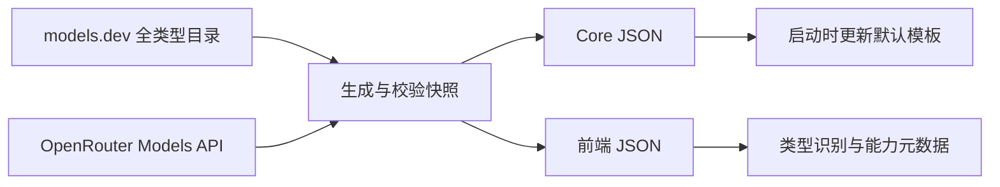

# 上游模型目录

默认模型名单来自公共目录，YAML 只保留供应商说明、地址、OCR/搜索/翻译服务配置及本地已核验的免费模型选择策略。

## 数据流



生成器在 `frontend/scripts/generate_upstream_model_catalog.py`，只使用 Python 标准库。

- [models.dev](https://models.dev/) 使用 `https://models.dev/api.json?type=all`，避免遗漏 embedding、图像、语音等专用类型。模型 ID、模态、类型及 token 限制来自上游；供应商名称到目录 ID 的映射仍是本地适配配置。
- [OpenRouter Models API](https://openrouter.ai/docs/api/api-reference/models/list-all-models-and-their-properties) 使用 `output_modalities=all` 获取全类型列表，决定 OpenRouter 模型列表、模态和限制。models.dev 仅为仍存在的同 ID 模型补充类型，不把其历史条目重新加入可选模板。
- 多个地区目录 ID 按配置顺序作为备用源，不合并不同地区的模型供给。当前 SenseNova 默认模板只纳入自身命名空间，已有用户配置不因此删除。
- `model_type` 保存专用类型的运行时映射；普通多模态聊天模型仍是 `llm`，`vision` 表示图片/视频输入能力。`max_input` 优先于 `context`，token 限制保存为精确整数，不转换为存在单位歧义的 K/M。

## 构建与刷新

从仓库根目录准备本地快照：

```sh
make model-catalog
```

也可在 frontend 目录运行：

```sh
pnpm gen:model-catalog
pnpm gen:model-catalog --refresh
```

默认写入以下两个生成文件，它们不进入 Git：

- `backend/core/config/upstream_model_catalog.json`
- `frontend/src/modules/modelProvider/upstreamModelCatalog.json`

前端 `predev/prebuild` 自动准备快照；完整仓库同时写入 Core 文件，因此桌面打包会携带数据。仅有 frontend 的 Docker 构建上下文只写前端文件。Core 镜像在自身 build 阶段准备 Core 文件。两个镜像独立构建时各自使用构建时刻的快照，后续计划通过 API 统一模态元数据。

本地运行管理器在 Core 编译前，通过现有 uv/Python 环境准备两个文件，避免依赖前端构建完成顺序。手工 `go run` 或 `core-dev` 容器调试前先执行 `make model-catalog`。桌面 Windows 的前端生成入口通过 uv 启动 Python；Unix 默认使用 `python3`，可设置 `LAZYMIND_CATALOG_PYTHON` 指定解释器路径。

有效快照在 24 小时内复用并同步给两个输出；`--refresh` 跳过时间缓存。网络暂时失败会重试，最终仍失败时保留最近一次通过校验的快照，记录其原生成时间并输出警告。首次构建没有有效快照则失败，不回退到硬编码模型名单。旧版本无 schema 字段的快照可在离线升级时保留，但每次构建仍尝试更新，不冒充新版数据。

每个输出通过临时文件加原子替换写入。Core 正常运行只读快照，不访问公共目录。Docker 缓存可能复用已构建层；要强制重新下载，使用 `docker compose build --no-cache core frontend`。只重启已有镜像不会更新目录。

## 同步边界

默认路径不读取 `model_providers` 的 YAML 模型名单，也不以其中的类型覆盖上游；供应商缺失或目录为空时不恢复旧名单。OCR、搜索、翻译和数据源目录仍按原配置加载。

上游同步在同一事务中更新供应商及默认模板。非空目录可以淘汰过期模板，但不会删除用户分组中的模型、已选默认模型或自定义模型。目录缺项不等于用户 Key 无权使用；已有配置可继续使用，未收录模型可手工添加。上游目录不能保证当前账号的实际可用性。

显式设置 `LAZYMIND_HARDCODED_MODEL_CATALOG=1` 可使用旧 YAML 启动路径，默认不启用。它只用于兼容回退；旧路径仍遵守原有目录同步删除规则。

目录保留上游原始输入/输出模态，未知模型不推测。当前默认模型选择器不展示输入/输出模态行；能力元数据仍用于类型识别及校验。测试和 TypeScript 检查允许生成文件不存在，使用固定 fixture；生产构建仍由 prebuild 校验和准备目录。

## 发现、分类和上下文

实时 `/models` 响应先使用明确的任务/模态证据，再用公共目录识别索引补全 ID-only 条目。识别索引覆盖 models.dev 全部供应商及 OpenRouter，不会因此扩展供应商模板或自动导入模型。匹配依次使用供应商内精确 ID、全局精确 ID、保留版本后缀的 basename，最后统一大小写并忽略 basename 中的 `.`、`-`、`_`。版本、参数规模和 `:free` 等后缀保留；不使用子串或编辑距离。同名类型冲突保持未分类，用户手动类型不被覆盖。

发现时的供应商差异放在发现适配层：硅基流动合并完整基线与按官方 `sub_type` 查询取得的分类证据；同一模型的能力合并而不覆盖。vLLM 使用实际响应的 `max_model_len` 作为上下文窗口，优先于通用字段；精确整数从发现、添加到编辑保留，未分类模型也可保存该值。`root` 仅辅助模型身份识别，不读取服务器路径。

未分类模型可添加到库存，仍需明确类型才能用于默认选型、连接测试或实际运行。已分类但无运行时适配器的组合明确显示暂不支持；公共目录收录不代表 LazyMind 能执行，也不代表当前账户有权限。

## 供应商配置与运行边界

供应商页面已采用品牌父层和独立服务叶子，模型服务与默认模型为分开的设置入口。同品牌不同套餐分别保存地址、凭据和库存；自定义供应商保持独立。旧连接迁移保留供应商、兼容组、模型、默认选择与固定会话 UUID，只有官方地址可以唯一证明服务身份时才原位重绑。

每个供应商可保存多个秘钥，同时最多启用一个。保存/替换/启用与连接验证已解绑；`/models` 不支持或失败不撤销已保存 Key，也不阻止测试明确指定的可运行模型。修改 API 地址保留秘钥池和启用项，只使旧验证过期。明确配置的无认证自建端点可在无 Key 时发现和调用。备份保存完整加密池与活动索引，恢复保持服务身份及活动选择。

目录发现、连接检查和实际调用共用地址规范化规则，保留 `/v1`、`/v3`、`/v4`、网关前缀和末尾斜线的正确语义。连接失败使用安全分类，区分鉴权、权限、模型不存在、额度、限流、超时和目录不支持。秘钥检查成功后，远端去重总数少于 5 时，自动加入其中可运行且已分类的模型，遇到未知或不支持类型同时打开侧栏；总数 5 个及以上仅打开同步侧栏，由用户选择。

运行能力以固定 LazyLLM 子模块的真实适配器为准，前端、Core 与算法 probe 保持一致：

- DeepSeek、Kimi、Claude 当前只有对话适配器；不能把目录中的向量模型作为这些协议的可运行配置。
- 重排保留，已适配来源为 Aiping、GLM、OpenAI 兼容网关、Qwen、SiliconFlow。知识库与临时文件检索共用请求级角色可用性判断，使用可选默认重排模型；未配置时保留原召回结果。固定子模块的 SiliconFlow 重排器会继承向量 URL 后缀，LazyMind 配置注入层仅对此组合补齐显式 `/rerank` 端点，保留代理前缀与 API 版本。
- OpenRouter 当前支持对话、文本向量、生图、视频、TTS、STT；重排、图像编辑和多模态向量未开放。OpenAI 兼容来源保留现有自部署多模态向量 fallback，但不会因为 HTTP 兼容就自动获得生图或语音适配器。

支持矩阵在 `backend/core/modelprovider/model_classification.go`、`frontend/src/modules/modelProvider/modelCapabilities.ts` 和 `algorithm/lazymind/chat/model_probe/runtime_support.py`；注册表契约测试防止与固定子模块漂移。供应商官方能力仍需单独的具体模型/账户验证。

供应商名称后的信息入口展示真实简介、官网和产品资源，接入帮助默认折叠；维护规则见 [供应商资料页](provider-information.md)。

## 验证

```sh
python3 -m unittest discover -s scripts/tests -p test_upstream_model_catalog.py -v
python3 -m flake8 frontend/scripts/generate_upstream_model_catalog.py scripts/tests/test_upstream_model_catalog.py
cd backend/core
go test ./modelprovider -count=1
```

分别在 `local/local-runtime-manager`、`frontend` 执行：

```sh
go test ./... -count=1
```

```sh
pnpm test:model-settings
pnpm build
```

当前已实施供应商优先布局、协议配置、多 Key 与旧数据迁移；[供应商优先的模型设置说明](../plan/2026-10-22-provider-first-model-settings.md) 记录实现边界。

CI 的 `test-workflow-panel` 保留既有任务 ID 和检查名称，使用 frozen lockfile 并运行完整前端测试，包含模型页面、设置守卫和聊天选择器。`pnpm test:model-settings` 是相同环境下的定向回归入口。

升级/备份闭环回归为 `backend/core/migrate/provider_upgrade_backup_test.go`：隔离数据库中串联真实 SQL、双 Key 密文、套餐重绑、默认/会话引用与加密备份恢复。PostgreSQL 通过 `MIGRATION_TEST_POSTGRES_DSN` 启用，测试创建并清理独立临时数据库；不覆盖云端传输与签名。
