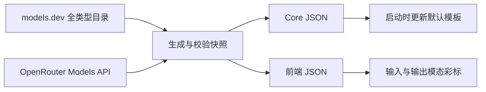

# 上游模型目录

默认模型名单来自公共目录，YAML 只保留供应商说明、地址、OCR/搜索/翻译服务配置及本地已核验的免费模型选择策略。

## 数据流



生成器在 `frontend/scripts/generate_upstream_model_catalog.py`，只使用 Python 标准库。

- [models.dev](https://models.dev/) 使用 `https://models.dev/api.json?type=all`，避免遗漏 embedding、图像、语音等专用类型。模型 ID、模态、类型及 token 限制来自上游；供应商名称到目录 ID 的映射仍是本地适配配置。
- [OpenRouter Models API](https://openrouter.ai/docs/api/api-reference/models/list-all-models-and-their-properties) 决定 OpenRouter 模型列表、模态和限制。models.dev 仅为仍存在的同 ID 模型补充类型，不把其历史条目重新加入可选模板。
- 多个地区目录 ID 按配置顺序作为备用源，不合并不同地区的模型供给。当前 SenseNova 默认模板只纳入自身命名空间，已有用户配置不因此删除。
- `model_type` 保存专用类型的运行时映射；普通多模态聊天模型仍是 `llm`，`vision` 表示图片/视频输入能力。`max_input` 优先于 `context`，token 限制保存为精确整数，不转换为存在单位歧义的 K/M。

## 构建与刷新

从仓库根目录准备本地快照：

```sh
make model-catalog
```

也可在 frontend 目录运行：

```sh
pnpm gen:model-catalog
pnpm gen:model-catalog --refresh
```

默认写入以下两个生成文件，它们不进入 Git：

- `backend/core/config/upstream_model_catalog.json`
- `frontend/src/modules/modelProvider/upstreamModelCatalog.json`

前端 `predev/prebuild` 自动准备快照；完整仓库同时写入 Core 文件，因此桌面打包会携带数据。仅有 frontend 的 Docker 构建上下文只写前端文件。Core 镜像在自身 build 阶段准备 Core 文件。两个镜像独立构建时各自使用构建时刻的快照，后续计划通过 API 统一模态元数据。

本地运行管理器在 Core 编译前，通过现有 uv/Python 环境准备两个文件，避免依赖前端构建完成顺序。手工 `go run` 或 `core-dev` 容器调试前先执行 `make model-catalog`。桌面 Windows 的前端生成入口通过 uv 启动 Python；Unix 默认使用 `python3`，可设置 `LAZYMIND_CATALOG_PYTHON` 指定解释器路径。

有效快照在 24 小时内复用并同步给两个输出；`--refresh` 跳过时间缓存。网络暂时失败会重试，最终仍失败时保留最近一次通过校验的快照，记录其原生成时间并输出警告。首次构建没有有效快照则失败，不回退到硬编码模型名单。旧版本无 schema 字段的快照可在离线升级时保留，但每次构建仍尝试更新，不冒充新版数据。

每个输出通过临时文件加原子替换写入。Core 正常运行只读快照，不访问公共目录。Docker 缓存可能复用已构建层；要强制重新下载，使用 `docker compose build --no-cache core frontend`。只重启已有镜像不会更新目录。

## 同步边界

默认路径不读取 `model_providers` 的 YAML 模型名单，也不以其中的类型覆盖上游；供应商缺失或目录为空时不恢复旧名单。OCR、搜索、翻译和数据源目录仍按原配置加载。

上游同步在同一事务中更新供应商及默认模板。非空目录可以淘汰过期模板，但不会删除用户分组中的模型、已选默认模型或自定义模型。目录缺项不等于用户 Key 无权使用；已有配置可继续使用，未收录模型可手工添加。上游目录不能保证当前账号的实际可用性。

显式设置 `LAZYMIND_HARDCODED_MODEL_CATALOG=1` 可使用旧 YAML 启动路径，默认不启用。它只用于兼容回退；旧路径仍遵守原有目录同步删除规则。

前端彩标只展示目录确认的文字、图片、音频、视频、文件输入/输出能力，未知模型不推测。测试和 TypeScript 检查允许生成文件不存在，使用固定 fixture；生产构建仍由 prebuild 校验和准备目录。

## 验证

```sh
python3 -m unittest discover -s scripts/tests -p test_upstream_model_catalog.py -v
python3 -m flake8 frontend/scripts/generate_upstream_model_catalog.py scripts/tests/test_upstream_model_catalog.py
cd backend/core
go test ./modelprovider -count=1
```

分别在 `local/local-runtime-manager`、`frontend` 执行：

```sh
go test ./... -count=1
```

```sh
pnpm exec vitest run src/modules/modelProvider --silent
pnpm build
```

下一阶段见 [供应商优先的模型设置计划](../plan/2026-10-22-provider-first-model-settings.md)。本阶段没有实施供应商/协议/多 Key 实体迁移或页面布局重写。
