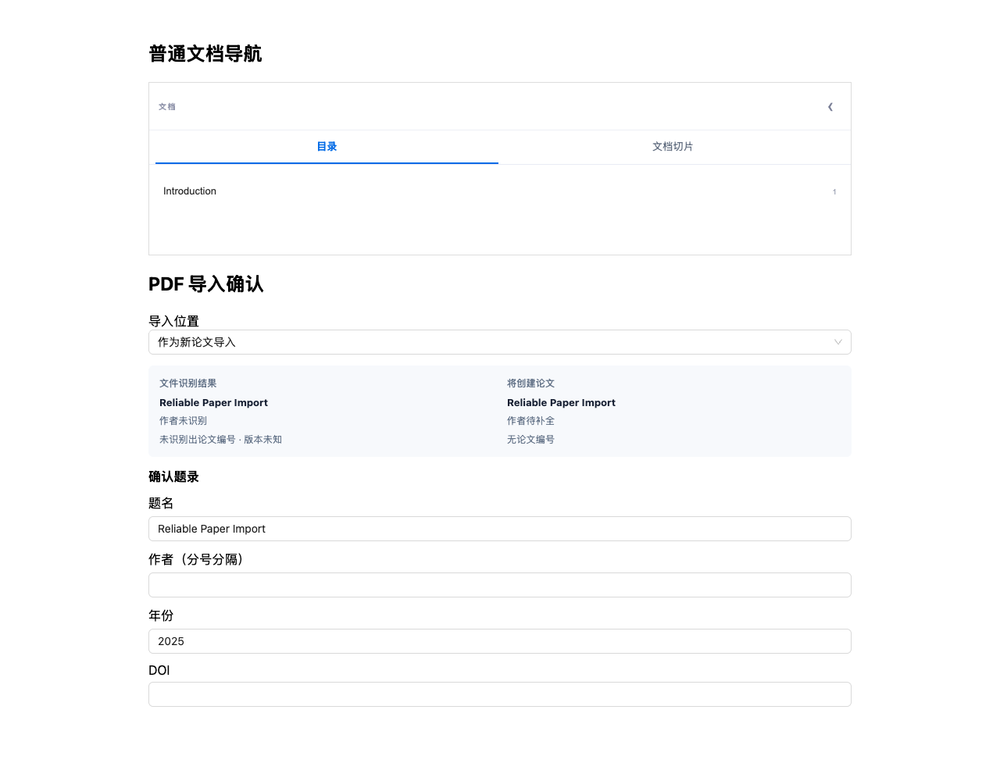
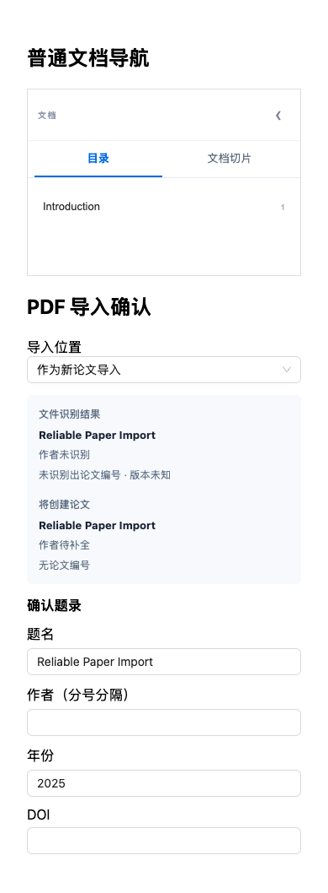

# 论文库缺陷修复与验证（2026-11-13）

范围：[飞书 Bug 表](https://sensetime.feishu.cn/base/FV8sb9rMaamnOpsnJWucgyc0nuh?table=tblGWVhMOBaCdPtw)，读取全表 rev 82，共 13 条，无后续分页。提交前再次读取仍为 13 条。编号 0007/0008 不在本次表内，不补造记录。

## 逐项排查

| Bug | 根因与处理 | 回归证据 |
| --- | --- | --- |
| 0001、0012 | 无 RAG / 无算法时仍显示 disabled 必填算法控件；隐藏不适用选择器，允许保留原算法仅修改名称 | UpdateModal 组件测试包含零算法与多算法已存库 |
| 0002 | 普通文档复用了论文专用导航；按用户确认只保留目录/分块，不挂载引用与生词组件 | Sidebar 和 reader loading 测试；合成数据浏览器截图 |
| 0003 | Zotero 数据库路径 C:/... 被生成 file://C:/...，盘符被当成 authority | 共享 SQLite URI、真实文件只读/WAL测试 |
| 0004 | 本地 Zotero API 默认地址硬编码 Docker host | desktop/local 构建用 localhost，cloud/Docker 构建用 host.docker.internal；保留手工设置，组件测试 |
| 0005 | 截图附件错误为 SQL logic error: out of memory (1)，附件保存也使用错误 URI 的导入锁 | 锁与 Zotero 附件存储回归，不放宽文件访问安全边界 |
| 0006 | 截图显示编辑提交失败；Windows 锁路径与备份 metadata 额外字段均可造成写入失败 | 修复两条写入路径；备份恢复→编辑实际后端回归。截图无原始错误，无法证明当次唯一路径 |
| 0009、0010 | 截图已成功识别 PDF/BibTeX，失败发生在提交；Windows 导入共用错误 URI 的锁 | 锁回归及既有 PDF/BibTeX 导入组件测试，未发现独立解析故障 |
| 0011 | Windows drive 前缺少斜杠；统一生成 file:///C:/...，转义特殊字符 | URI 表驱动和真实 SQLite I/O；Windows CI 专项 |
| 0013 | 失败诊断只区分 PDF 保存与否，未区分题录已入库 | worker、历史批次 API 和前端 enrichment 失败语义回归，保留错误详情和重试 |
| 0014 | PDF 确认页无可编辑字段 | 增加标题/作者/年份/DOI；实际组件操作与提交测试，原始身份信息独立保留 |
| 0015 | 备份 metadata.confidence / identifiers.pmid 等扩展字段原样写回，严格 DTO 拒绝 | 写请求投影允许字段；恢复后编辑→补 PDF 后端集成回归，原笔记和扩展字段保留 |

SQLite URI 规则依据：[SQLite URI filenames](https://www.sqlite.org/uri.html)。使用原有只读事务和锁语义，不使用 immutable/nolock 绕过数据库保护。

## 本地验证

- `go test ./academic ./paperlibrary -count=1`：两个包通过（约 123 秒）。使用测试临时数据库，不连接用户 core 库。
- 前端 paper 全目录、UpdateModal、reader loading、Sidebar：44 文件，384 passed、1 原有 skipped。
- `pnpm build`：通过；保留现有 chunk 大小警告。
- 独立审查复跑备份恢复、失败诊断及相关组件测试，无阻断发现。
- Windows amd64 的 academic 测试交叉编译通过。新增 Windows Academic Regression workflow，在真实 Windows runner 运行 SQLite URI、锁和 Zotero 附件测试；最终运行状态以 PR checks 为准。
- Playwright 对真实组件的合成数据页面验证题名/作者/DOI输入、目录/分块切换及 390px/1280px 展示。截图不是安装包端到端结果。

## 展示

## 验证边界

本机为 macOS ARM64，Docker daemon 当前不可连接，未部署或重启 8090，也未改数据库挂载、初始化或原有数据。真实 Windows/macOS 安装包的完整业务回归仍需包含本次修复的新包。已有安装包不会因源码提交而自动生效。全量 `typecheck:all` 有既有报错；本次运行项目 CI 所要求的 `typecheck`，不以全量类型检查通过作承诺。
