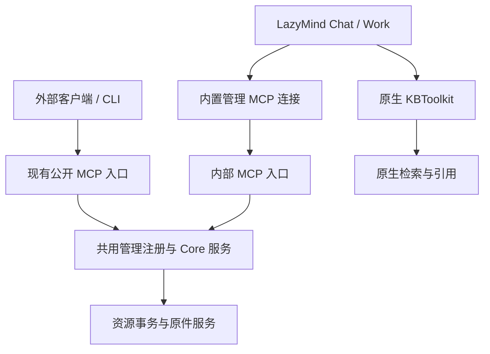

# Specification snapshot

Source: https://app.notion.com/p/3feb8b30a5b081e19c8ce5db02855797

USER OVERRIDE (2026-10-20): permissions inherit existing user permissions. Only deletion and cross-library moves require confirmation in LazyMind Chat/Work. Create/upload/metadata/same-library moves do not require extra confirmation. External clients own their interaction policy; no public confirmation tool/ticket/flag.

Here is the result of "fetch" for the Page with URL https://app.notion.com/p/3feb8b30a5b081e19c8ce5db02855797 as of 2026-10-20T02:30:47.722Z:
<page url="https://app.notion.com/p/3feb8b30a5b081e19c8ce5db02855797" icon="📚">
<ancestor-path>
<parent-page url="https://app.notion.com/p/3feb8b30a5b0811391eef8f098c608c3" title="W43 2026-10-19 ~ 2026-10-25"/>
<ancestor-2-page url="https://app.notion.com/p/3f4b8b30a5b081b7b110dae6c0e319b6" title="2026-10"/>
<ancestor-3-page url="https://app.notion.com/p/38bb8b30a5b081a18d98d198c10105a1" title="工作记录 2026"/>
</ancestor-path>
<properties>
{"title":"LazyMind Agent 知识库管理 MCP｜详细设计"}
</properties>
<iconMetadata>{"type":"emoji","emoji":"📚"}</iconMetadata>
<content>
评审稿 1.8 整理版 · <mention-date start="2026-10-20"/> · 状态：设计方案，尚未实施。
本版收敛首期实现：LazyMind 内置 MCP 仅暴露 9 项管理工具，内容检索仍使用原生 KBToolkit；跨库移动采用有界同步执行并通过 MCP 返回超限信息；跨库移动纳入高风险确认；大规模分阶段异步移动后置。
本方案是论文阅读与论文自动扩展的前置能力。用户可以在 Chat 或 Work 中要求 Agent 管理知识库，无需切换到知识库页面。工具直接返回可核对的资源结果，页面和 Agent 共用业务规则。
<table_of_contents/>
# 1. 方案结论与本期范围
**在现有 Capability MCP 上增加知识库管理能力，LazyMind 自己默认使用；原生 KBToolkit 继续负责内容读取和检索。** 外部接入优先沿用现有账号 JWT 与 CLI／bridge，不以新增 OAuth 为管理功能的前置。
<table fit-page-width="true" header-row="true">
<tr>
<td>项目</td>
<td>本方案</td>
</tr>
<tr>
<td>管理工具</td>
<td>共 9 项：知识库列表、目录与文档列表、文档统计、创建库、创建文件夹、修改元数据、移动、删除、上传</td>
</tr>
<tr>
<td>MCP 服务</td>
<td>扩展现有 `backend/core/capability/mcp/server.go`、Service、ports、adapter；增加 7 项注册，增强已有 2 项管理查询</td>
</tr>
<tr>
<td>LazyMind 自用</td>
<td>Chat／Work 默认启用，按当前用户和可信执行上下文自动鉴权；只激活管理 9 项</td>
</tr>
<tr>
<td>检索</td>
<td>保留原生 KBToolkit 的 5 项读取／检索能力；LazyMind 不激活 MCP `knowledge.search`，也不重复加载 `knowledge.document.get`</td>
</tr>
<tr>
<td>外部兼容</td>
<td>原 `/api/core/mcp/capabilities/v1` 保留；已有外部 get/search 继续可用，现有 CLI／bridge 保持单上游</td>
</tr>
<tr>
<td>文件来源</td>
<td>当前对话附件、宿主可访问的本地文件、可下载的网络文件、LazyMind Work 产物</td>
</tr>
<tr>
<td>移动</td>
<td>同库及有界跨库移动文档与完整文件夹；跨库保留整棵子树和空目录，超限由 MCP 返回可行动的错误，未来再扩展异步</td>
</tr>
<tr>
<td>执行方式</td>
<td>首期有边界的同步提交；超限返回结构化 MCP 错误供 Agent 决策；资源移动成功不等于解析／索引就绪</td>
</tr>
<tr>
<td>确认</td>
<td>LazyMind 宿主在创建、删除及跨库移动前确认，同库明确移动与元数据修改直接执行；外部有权且目标明确的 MCP 请求直接执行</td>
</tr>
<tr>
<td>本期不包含</td>
<td>原件替换、独立重新解析／切片／索引工具、大规模跨库分阶段异步移动及操作任务查询／重试／取消平台；不新增 KnowledgeManagementToolkit</td>
</tr>
</table>
**外部接入范围的建议：** 本期提供已有 CLI／bridge 登录和有效 Bearer 接入。此前提出的“第三方只填写 URL，即可自动进入浏览器登录授权”仍需额外 OAuth 接入能力；如要求同期交付，则另行追加该部分，不能把现有 JWT 认证算作已实现这一体验。
# 2. 服务边界与工具数量
## 2.1 复用的现有能力
当前服务已注册以下 4 个知识库工具：
<table fit-page-width="true" header-row="true">
<tr>
<td>已有工具</td>
<td>能力</td>
<td>主要参数</td>
</tr>
<tr>
<td>`knowledge.list`</td>
<td>查询有权访问的知识库</td>
<td>`keyword`、`tags`、`page`</td>
</tr>
<tr>
<td>`knowledge.document.list`</td>
<td>查询知识库文档</td>
<td>`knowledge_id`、`name`、`path`、`page`</td>
</tr>
<tr>
<td>`knowledge.document.get`</td>
<td>文档信息及可选内容／切片读取</td>
<td>`knowledge_id`、`document_id`、`include_content`、`include_chunks`、`chunks_page`</td>
</tr>
<tr>
<td>`knowledge.search`</td>
<td>返回相关切片命中</td>
<td>`knowledge_ids`、`query`、`top_k`</td>
</tr>
</table>
依据：[当前工具注册](https://github.com/LazyAGI/LazyMind/blob/81683cfbea2f0a1cb0c696327abb77e7e412df37/backend/core/capability/mcp/server.go#L83-L110)、[已发布参数与返回结构](https://github.com/LazyAGI/LazyMind/blob/81683cfbea2f0a1cb0c696327abb77e7e412df37/backend/core/capability/types.go#L211-L365)。本页源码事实以该固定提交为核对基线；下文新增能力均为设计。
新增 7 个 MCP 注册后，服务端知识库相关工具为 **11 项＝管理 9 项＋已有外部读取／检索 2 项**。统计已有业务实现，因此净新增管理业务能力为 6 项。LazyMind 内置 MCP 通过 `allowed_tools` 只暴露管理 9 项，明确不加载 `knowledge.search`、`knowledge.document.get`，检索／读取使用原生 KBToolkit 的 5 项。外部客户端仍可使用原有 get/search。工具不可见是 Agent 侧加载政策，不替代服务端对写操作的逐动作授权。
## 2.2 职责划分

<table fit-page-width="true" header-row="true">
<tr>
<td>层次</td>
<td>职责</td>
</tr>
<tr>
<td>LazyMind 宿主</td>
<td>用户身份与运行范围、默认工具白名单、创建／删除／跨库移动确认、文件来源适配、进度与结果展示，向 Agent 原样传递结构化超限诊断</td>
</tr>
<tr>
<td>MCP adapter</td>
<td>参数校验、工具注册、身份解析、将结果映射为 MCP 返回；不重复实现资源业务</td>
</tr>
<tr>
<td>Core 共享业务服务</td>
<td>知识库／目录／文档事务、逐动作权限、原件获取与绑定、同步移动预算校验、真实处理状态和幂等回执；知识库页面和 MCP 共用</td>
</tr>
<tr>
<td>原生 KBToolkit</td>
<td>继续使用现有召回、重排、关键词、上下文扩展、图片与引用机制；补充有效资源归属过滤</td>
</tr>
<tr>
<td>学术模块</td>
<td>论文身份、候选、版本和论文关联；内部复用 Core 原件服务与文档绑定服务</td>
</tr>
</table>
# 3. 管理工具与参数契约
本节以实际 **MCP wire name** 为唯一对外名称。`upload_documents`、`move_knowledge_resources` 等是业务能力称呼，不另注册一套同义工具。已有两个列表工具保留已发布的参数命名和默认值。
## 3.1 共用约定
```typescript
type ResourceRef =
  | { kind: "knowledge_base"; knowledge_base_id: string }
  | { kind: "folder"; knowledge_base_id: string; folder_id: string }
  | { kind: "document"; knowledge_base_id: string; document_id: string };

type PageRequest = {
  page_size?: number;   // 默认 20，范围 1–100
  page_token?: string;
};
```
- 知识库使用 Core dataset ID；文件夹内部沿用 FOLDER 类型的 Document ID。不能把外部算法 KbID 当成 Core ID。
- 查询返回准确名称、完整逻辑路径、资源引用、当前状态、允许动作和定位入口。分页不能静默截断；只有确认完整查找后才能判定目标唯一。
- 用户只给名称或描述时，Agent 先查询。同名库、文件夹或文档展示候选并要求选择；不存在时要求重指，或询问是否创建。写工具最终接收已确定的 ID。
- 写前服务端复核资源实际归属、当前权限与冲突；不得自行覆盖、移动、合并或加后缀解决歧义。
- `user_id`、`tenant_id`、凭据、执行范围、批准结果、内部幂等键由可信运行上下文提供，不交给模型填写。公共参数不增加 `confirmed`、`force`、`confirmation_ref` 或 `operation_id`。
## 3.2 M1：knowledge.list
**能力：** 发现知识库、精确查找名称、按 ID 获取库信息，筛选适合读取或导入的目标。
<table fit-page-width="true" header-row="true">
<tr>
<td>参数</td>
<td>必填</td>
<td>含义与默认值</td>
</tr>
<tr>
<td>`keyword`</td>
<td>否</td>
<td>名称／描述关键词，默认空</td>
</tr>
<tr>
<td>`tags`</td>
<td>否</td>
<td>标签筛选，保留已有契约</td>
</tr>
<tr>
<td>`page`</td>
<td>否</td>
<td>原 `page_size/page_token` 分页结构</td>
</tr>
<tr>
<td>`knowledge_base_ids`</td>
<td>否</td>
<td>按 Core ID 查询；提供时为非空字符串数组</td>
</tr>
<tr>
<td>`match`</td>
<td>否</td>
<td>`contains`／`exact`，默认 contains；exact 按名称精确匹配</td>
</tr>
<tr>
<td>`scene`</td>
<td>否</td>
<td>`general`／`paper_collection`</td>
</tr>
<tr>
<td>`required_action`</td>
<td>否</td>
<td>`read`／`upload`／`write`，默认 read；寻找导入目标时可选 upload</td>
</tr>
</table>
**返回：** 保留 `items/page` 及 `items[].id`，补充 `resource_ref`、描述、场景、owner／来源、`allowed_actions`、入口和分页完整性。总数只在能准确提供时返回。
创建前的同名检查应涵盖全部可见同名库；不能用 upload 筛选先隐藏同名只读库，再静默重复创建。
## 3.3 M2：knowledge.document.list
**能力：** 查询目录树、文档、文件夹及当前状态，支持未解析和解析失败的文档。
<table fit-page-width="true" header-row="true">
<tr>
<td>参数</td>
<td>必填</td>
<td>含义与默认值</td>
</tr>
<tr>
<td>`knowledge_id`</td>
<td>与下一项二选一</td>
<td>保留已有单库参数</td>
</tr>
<tr>
<td>`knowledge_ids`</td>
<td>与上一项二选一</td>
<td>新增多库参数；非空 Core ID 数组</td>
</tr>
<tr>
<td>`name`</td>
<td>否</td>
<td>保留已有名称筛选；对应业务关键词</td>
</tr>
<tr>
<td>`path`</td>
<td>否</td>
<td>保留已有上传 relative_path 筛选，不改成逻辑父目录或宿主磁盘路径</td>
</tr>
<tr>
<td>`page`</td>
<td>否</td>
<td>保留已有分页结构</td>
</tr>
<tr>
<td>`resource_ids`</td>
<td>否</td>
<td>已知资源 ID 筛选；不与相互矛盾的筛选条件混用</td>
</tr>
<tr>
<td>`resource_type`</td>
<td>否</td>
<td>`document`／`folder`／`all`；省略仍为 document，管理浏览显式传 all</td>
</tr>
<tr>
<td>`parent_id`</td>
<td>否</td>
<td>省略沿用全库范围；`""` 明确根目录；实际 ID 表示该文件夹。指定目录时限单库</td>
</tr>
<tr>
<td>`recursive`</td>
<td>否</td>
<td>默认 true；false 只列指定范围的直接子项</td>
</tr>
<tr>
<td>`match`</td>
<td>否</td>
<td>`contains`／`exact`，默认 contains</td>
</tr>
</table>
**返回：** 保留 `items/page`，补充资源类型、完整路径、父目录、允许动作、入口；文档附大小、格式以及可确认的上传／解析／索引状态。文件夹不伪装成未解析文档。多库结果统一排序和分页，不能拼接各库第一页冒充完整清单。
## 3.4 M3：knowledge.document.aggregate
**能力：** 回答文档有多少、总大小、按格式／知识库／标签等如何分布。只做元数据统计，不读取正文、合并文档或整理目录。
<table fit-page-width="true" header-row="true">
<tr>
<td>参数</td>
<td>必填</td>
<td>含义</td>
</tr>
<tr>
<td>`knowledge_base_ids`</td>
<td>否</td>
<td>统计范围；省略时仍受当前用户与运行范围限制</td>
</tr>
<tr>
<td>`file_types`</td>
<td>否</td>
<td>文件格式筛选</td>
</tr>
<tr>
<td>`document_stages`</td>
<td>否</td>
<td>已有 document_stage 筛选</td>
</tr>
<tr>
<td>`data_source_types`</td>
<td>否</td>
<td>来源类型筛选</td>
</tr>
<tr>
<td>`creators`</td>
<td>否</td>
<td>创建人筛选</td>
</tr>
<tr>
<td>`tags`</td>
<td>否</td>
<td>标签筛选</td>
</tr>
<tr>
<td>`group_by`</td>
<td>否</td>
<td>可组合 dataset_id、dataset_display、file_type、document_stage、data_source_type、creator、tag</td>
</tr>
</table>
**返回：** `total_count`、`total_size`、`groups`，每组包含 key／count／size。统计去重总量和分组量分别说明；多标签文档可进入多个组。
**首期执行边界：** 限制实际扫描的文档规模、`group_by` 个数及组合复杂度；不得无上限读取所有可访问库再在内存中聚合。超过配置预算时，MCP 返回 `QUERY_TOO_LARGE`，附实际／允许规模、超限维度和 `narrow_knowledge_scope`、`reduce_group_by` 等可执行建议，由 Agent 决定缩小范围或征询用户。规模阈值由实际性能测试和部署配置确定，不在设计稿中硬编码。后续按需要下推为数据库侧聚合。
现有统计排除文件夹，且 `document_stage` 不是独立、精确的解析／切片／索引状态。删除确认所需递归文件夹与文档数量由预检直接计算，不能拿这个统计工具替代。依据：[统计实现](https://github.com/LazyAGI/LazyMind/blob/81683cfbea2f0a1cb0c696327abb77e7e412df37/backend/core/doc/system_query.go#L13-L118)、[状态来源](https://github.com/LazyAGI/LazyMind/blob/81683cfbea2f0a1cb0c696327abb77e7e412df37/backend/core/doc/document.go#L2130-L2157)。
## 3.5 M4：knowledge.create
<table fit-page-width="true" header-row="true">
<tr>
<td>参数</td>
<td>必填</td>
<td>含义与默认值</td>
</tr>
<tr>
<td>`name`</td>
<td>是</td>
<td>非空知识库名称</td>
</tr>
<tr>
<td>`description`</td>
<td>否</td>
<td>默认空</td>
</tr>
<tr>
<td>`scene`</td>
<td>否</td>
<td>general／paper_collection，默认 general；与页面共用场景字段</td>
</tr>
<tr>
<td>`processing_level`</td>
<td>否</td>
<td>stored／parsed／chunked／indexed；省略按页面现有策略与依赖决定</td>
</tr>
</table>
名称缺失时补充或确认建议名称；已存在可见同名库时让用户选择使用已有库或换名。事务内复查冲突，不静默重复创建。
**返回：** 已提交的 `knowledge_base_id`、准确名称、描述、场景、处理策略和入口。继续建目录或导入时，Agent 用这个真实 ID 调用 M5／M9；Work 后续步骤沿用同一 ID。无需 `initial_documents` 等复合参数。
## 3.6 M5：knowledge.folder.create
<table fit-page-width="true" header-row="true">
<tr>
<td>参数</td>
<td>必填</td>
<td>含义与默认值</td>
</tr>
<tr>
<td>`knowledge_base_id`</td>
<td>是</td>
<td>目标库</td>
</tr>
<tr>
<td>`folders`</td>
<td>是</td>
<td>非空字符串数组；目录名或明确相对逻辑路径，例如 `理论`、`实验/复现`</td>
</tr>
<tr>
<td>`parent_id`</td>
<td>否</td>
<td>默认根目录</td>
</tr>
</table>
只创建明确提交路径范围内的目录；拒绝绝对路径、`..`、非法父目录。遇到同名返回候选，用户选择复用或改名；不静默合并。目录创建不触发文档解析。
**返回：** 各 `folder_id`、完整路径、成功／失败／跳过数量及定位入口。
## 3.7 M6：knowledge.resource.update_metadata
```typescript
type MetadataChanges = {
  name?: string;
  description?: string;
  scene?: "general" | "paper_collection";
  tags?: string[];
};

{
  items: Array<{
    target: ResourceRef;
    changes: MetadataChanges;
  }>;
}
```
`items` 必填非空，每项 changes 至少包含一个允许字段；仍按目标资源种类校验字段白名单，禁止跨类型修改。
<table fit-page-width="true" header-row="true">
<tr>
<td>资源类型</td>
<td>允许修改</td>
</tr>
<tr>
<td>knowledge_base</td>
<td>`name`、`description`、`scene`</td>
</tr>
<tr>
<td>folder</td>
<td>`name`</td>
</tr>
<tr>
<td>document</td>
<td>`name`、`tags`</td>
</tr>
</table>
tags 为最终标签数组，省略不改、空数组清空；name 不能空。不允许通过元数据修改位置、原件、归属、owner 或权限。资源不存在返回 NOT_FOUND，不能把 PATCH 变成创建。元数据修改不重新解析。
**返回：** 实际对象、修改前后字段、逐项结果、当前状态及入口。
## 3.8 M7：knowledge.resource.move
```typescript
{
  sources: ResourceRef[];
  destination:
    | { kind: "knowledge_base"; knowledge_base_id: string }
    | { kind: "folder"; knowledge_base_id: string; folder_id: string };
}
```
两项必填；sources 非空，仅允许 folder／document。destination 为知识库时表示目标库根目录，为文件夹时表示该目录。
文档与完整文件夹支持同库移动、移回根目录和跨库移动。跨库必须有用户明确指定的目标。文件夹包括全部后代与空目录；父子重复选择先去重。禁止移动到自身或后代，冲突不自动覆盖、合并或加后缀。源检查 WRITE，目标检查 UPLOAD。
**首期限制：** 同库移动执行常规权限与冲突检查；跨库移动前评估去重后的整树文档数、原件累计大小、预计准备／复制开销和剩余时间预算。超过任一部署配置上限时，以 MCP 结构化错误 `OPERATION_TOO_LARGE` 返回实际值、上限与 `narrow_scope`、`split_by_subfolder` 等可选建议。由 Agent 选择后续步骤；用户要求整棵子树整体成功／失败时，不得擅自拆为多个部分移动。跨库移动在 LazyMind 中必须经过高风险确认。
**返回：** 各根资源的原位置、新位置、新旧 ID 映射、子树数量、资源移动结果、目标处理状态和源回收状态；超限为带诊断信息的错误，不伪装为成功。跨库不承诺 ID 不变。完整提交过程见第 5 节。
## 3.9 M8：knowledge.resource.delete
```typescript
{ targets: ResourceRef[] }
```
targets 必填非空，支持知识库／文件夹／文档，递归展开并去除父子重复选择。执行前核对对象与权限；LazyMind 确认要求见第 7 节。
**本方案默认删除语义：** 同步提交逻辑删除，使目录、内容读取及正常检索立即不可见；文档标签关联和活动处理绑定同时失效。原件、解析与索引数据回收单独报告，阻止旧任务重新发布已删除资源。保留全局标签定义、任务历史和已有 Chat／Work 记录。
暂存数据仍存在不代表有恢复能力。没有完整恢复入口时明确提示“删除后不可恢复”。整库删除建议限 owner 或本部署明确授予该权限的管理员；文件夹／文档删除按对象写权限及数据源删除能力处理。
**返回：** 实际删除范围、逐项数量、资源状态、数据回收状态、失败原因和恢复办法。
## 3.10 M9：knowledge.document.upload
业务称呼：`upload_documents`。
<table fit-page-width="true" header-row="true">
<tr>
<td>参数</td>
<td>必填</td>
<td>含义与默认值</td>
</tr>
<tr>
<td>`knowledge_base_id`</td>
<td>是</td>
<td>目标库</td>
</tr>
<tr>
<td>`files`</td>
<td>是</td>
<td>非空 UploadItem 数组，见第 4 节</td>
</tr>
<tr>
<td>`parent_id`</td>
<td>否</td>
<td>整批目标目录，默认根目录</td>
</tr>
<tr>
<td>`conflict_policy`</td>
<td>否</td>
<td>ask／skip_same_content，默认 ask</td>
</tr>
</table>
先校验来源访问权和目标权限，取得完整原件，再持久保存并创建目标知识库 Document。同名不同内容返回明确冲突，不替换原件。按目标库当前策略提交后续处理，不增加 wait／async／poll_interval 参数。
**完成条件：原件已持久保存，且 Document 已在目标库提交。** 只取得 URL、生成临时上传记录或收到任务已受理，都不算上传入库完成。保留来源文件，上传不变成移动本地文件或 Work 原件。
**返回：** 每个文件的实际 `document_id`、名称、位置、入口、上传结果和处理阶段；批量成功／处理中／失败分别汇总。处理提交失败但 Document 已创建时保留并返回 ID，恢复应针对该文档，不能重新上传制造副本。
# 4. 文件来源与共享下载能力
## 4.1 files 的四类来源
```typescript
type UploadSource =
  | { kind: "uploaded_file"; file_ref: string }
  | { kind: "local_file"; path: string }
  | { kind: "remote_file"; url: string }
  | { kind: "work_artifact"; artifact_id: string; revision_id?: string };

type UploadItem = { source: UploadSource; name?: string };
```
<table fit-page-width="true" header-row="true">
<tr>
<td>来源</td>
<td>谁提供文件</td>
<td>关键约束</td>
</tr>
<tr>
<td>uploaded_file</td>
<td>Core 已接收且当前用户可访问的完整原件</td>
<td>Chat 附件先由宿主转换为可验证 file_ref；会话 fr_、第三方私有附件 ID 不能直接冒充全局引用</td>
</tr>
<tr>
<td>local_file</td>
<td>实际宿主执行器或本地 bridge</td>
<td>在用户允许范围内按 Windows／Unix 规则读文件，传输字节后取得 file_ref；远程 Core 不能读取客户端盘符</td>
</tr>
<tr>
<td>remote_file</td>
<td>Core 共享原件服务</td>
<td>HTTP(S) 可下载文件；检查重定向、目标地址、大小、超时、格式、完整性和实际内容</td>
</tr>
<tr>
<td>work_artifact</td>
<td>已发布的 LazyMind Work 产物及具体交付版本</td>
<td>按产物权限取原件；旧产物没有 revision_id 时固定本次实际可见交付，不能读取未来版本</td>
</tr>
</table>
Codex／DSH 在本地生成的文件属于 local_file；只有经 LazyMind 产物机制发布并具备真实 artifact_id 的才属于 work_artifact。没有本地传输能力的直连客户端返回 LOCAL_FILE_BRIDGE_REQUIRED，不将本地路径发给远程 Core 盲读。
```json
{
  "knowledge_base_id": "ds_papers",
  "files": [
    {"source": {"kind": "uploaded_file", "file_ref": "已有上传回执中的引用"}},
    {"source": {"kind": "local_file", "path": "D:\\papers\\method.pdf"}},
    {"source": {"kind": "remote_file", "url": "https://example.org/paper.pdf"}},
    {"source": {"kind": "work_artifact", "artifact_id": "已有产物ID", "revision_id": "已有版本ID"}}
  ]
}
```
示例仅说明字段结构。实际引用来自用户输入或可信工具回执，不能由 Agent 虚构。
用户要求“上传目录下所有 PDF”时，已有宿主文件工具先完整枚举、筛选，再分批调用上传。需要保留层级时先创建逻辑文件夹，再按目标目录分组上传；空目录由文件夹工具创建。本期 files 每项是明确文件，不引入递归目录规划参数。
## 4.2 下载放在 Core，共享给入库和论文扩展
在 `backend/core/doc` 的文件／上传服务内抽出共享原件能力，复用 UploadSession／UploadedFile。附件、本地文件、网络 URL 和 Work 产物先通过各自可信来源适配取得受控 `file_ref`，再统一进入入库服务；`ImportOriginal` 不区分原件来自哪里。最小内部服务分成两步：
<table fit-page-width="true" header-row="true">
<tr>
<td>内部服务动作</td>
<td>输入</td>
<td>输出与边界</td>
</tr>
<tr>
<td>`AcquireRemoteOriginal`</td>
<td>可信 caller、URL、可选文件名／预期类型，服务端下载 policy</td>
<td>完整原件的 file_ref、实际 MIME／大小／内容哈希、最终 URL 和有效期；不创建 Document、不启动解析</td>
</tr>
<tr>
<td>`ImportOriginal`</td>
<td>caller、file_ref、目标库／目录、可选名称及来源元数据</td>
<td>实际 Document ID、目标位置及处理提交状态；独立检查来源和目标权限</td>
</tr>
</table>
- 普通直链入库：M9 取得原件，再绑定到目标知识库。
- 论文自动扩展：学术模块负责识别论文、选择候选链接和版本；需要文件时调用同一原件服务，需要入库时调用同一绑定服务，最后维护论文与 Document 关联。
- Core 内部直接调用共享 Go 服务；算法侧需要原件时经受信 Core API 访问。Core 不反向调用算法 `url_fetch` 完成下载。
- 不把摘要、落地页、登录页或已转换的 [parsed.md](http://parsed.md) 当作原件。需登录的来源通过已有授权来源适配器取得文件；下载器不继承 LazyMind Bearer／Cookie。
- `file_ref` 固定本次内容和来源权限，同一原件可用于多个目标，每次独立授权并创建目标 Document／上传记录；不能反复改写同一条 BOUND 记录。
- URL 不是内容身份。原件使用实际内容哈希；新版本产生新引用。显式 arXiv vN 在候选和镜像回退中保留，不能下载最新版后标成指定旧版。
- 未绑定原件有限保留，过期明确报错；入库后的原件独立持久保存，不依赖暂存引用一直存在。
已有会话 PDF 下载会直接触发会话解析，因此需抽出原件服务，而不是直接包装这一函数。依据：[现有下载与解析耦合](https://github.com/LazyAGI/LazyMind/blob/81683cfbea2f0a1cb0c696327abb77e7e412df37/algorithm/lazymind/chat/engine/tools/infra/web_search_support.py#L201-L250)、[现有上传绑定](https://github.com/LazyAGI/LazyMind/blob/81683cfbea2f0a1cb0c696327abb77e7e412df37/backend/core/doc/task.go#L2541-L2579)。
## 4.3 外部本地文件的数据通道
CLI／bridge 读取客户端本地文件，经现有分片／暂存能力取得 file_ref，再调用同一个 M9。可在现有入口下补薄 HTTP 上传路径：
```plain text
POST /api/core/mcp/capabilities/v1/uploads
PUT  /api/core/mcp/capabilities/v1/uploads/{id}/parts/{n}
POST /api/core/mcp/capabilities/v1/uploads/{id}/complete
```
这些不是新增 MCP 工具。每步校验账号、租户、上传会话归属和动作权限；complete 只登记完整原件，M9 才绑定 Document。无需改变现有 bridge 的单上游架构。
# 5. 同步执行、跨库移动与结果反馈
## 5.1 同步工具的完成定义
**首期采用有边界的同步执行。** 工具在本次 `tools/call` 中完成资源动作并直接返回结果；内部可做网络 I/O 和有界等待，既有文档处理机制继续工作，不要求 Agent 先拿任务 ID，再调用 get／control 工具。跨库移动预检整树文档数、原件大小、预计复制开销和执行预算；超限时本次调用不执行移动，返回 `OPERATION_TOO_LARGE` 及限制、实际范围和建议动作，让 Agent 决定缩小范围或向用户确认是否分批。参数改变或超出已确认范围必须重新确认。
<table fit-page-width="true" header-row="true">
<tr>
<td>动作</td>
<td>可以报告成功的时点</td>
<td>必须另列的状态</td>
</tr>
<tr>
<td>创建／改名／修改元数据</td>
<td>资源变更已提交并可核对</td>
<td>当前字段和入口</td>
</tr>
<tr>
<td>上传</td>
<td>原件持久保存，目标 Document 已提交</td>
<td>处理是否提交、解析／索引当前状态</td>
</tr>
<tr>
<td>同库移动</td>
<td>父目录变更及受影响统计已提交</td>
<td>实际原位置／目标位置</td>
</tr>
<tr>
<td>跨库移动</td>
<td>目标原件与完整资源归属已提交，源目录和内容检索不可见</td>
<td>目标解析／索引状态（可能暂时不可检索）、源物理回收；不能把 moved 写成 ready</td>
</tr>
<tr>
<td>删除</td>
<td>逻辑删除及目录／内容不可见已提交</td>
<td>原件、解析、索引回收阶段</td>
</tr>
</table>
`accepted/submitted` 只表示受理／提交阶段；不能写成解析成功，无法确认时返回 unknown。首期跨库移动的 `resource_status=moved` 与 `processing_status=processing/failed/ready` 独立；移动成功后，目标可能仍不可检索，必须在 MCP 结果中明确说明，Agent 不得宣称目标已就绪。只有达到目标库 `processing_level` 要求、且相应检索能力确实就绪的文档才进入正常内容检索和引用；stored 库返回 not_requested，不伪装成解析失败。
## 5.2 完整文件夹跨库移动
1. 展开并固定整棵子树，包含空目录、文档、名称、元数据和原件引用；检查源／目标权限、重名、结构、活动任务，以及文档数、原件大小、复制／准备开销与执行预算。超限直接返回 MCP `OPERATION_TOO_LARGE`；此时不创建目标或移除源。
2. 准备并校验全部目标原件，保留源文件，暂不发布活跃目标 Document。
3. 对一个根资源执行短事务：复核子树未变化，按新 ID 映射创建目录／文档与处理绑定，提交目标归属，逻辑移除源树，并保存新旧映射。资源绑定函数使用同一 tx。
4. 事务内保存待处理／待回收标记，事务后交给已有处理机制。实际交接成功才记 submitted；未交接记 not_submitted，不能声称已经后台运行。
5. 返回移动、目标处理、源回收三个结果。目标按自身策略重新处理；本期不迁移旧切片／索引。后续 Work 步骤使用返回的新 ID。
一个文件夹内部先准备齐全再提交，不逐文件部分移动；多个独立根资源可以分别成功／失败。准备失败保留源树；提交后解析失败报告“移动成功，目标解析失败”，不反向移动。**Agent 只能在用户允许分批、并接受失去整树原子性语义时，按子目录重新规划多个独立根资源调用；不可悄悄拆分原本必须整体移动的文件夹。** Core 数据库事务不宣称跨文件系统和外部索引全原子。
现有 transfer 路径包含后台任务及解析／算法绑定限制，不能简单收到 accepted 或 RUNNING 就报告移动完成。因此要补共享资源移动服务。依据：[Core 现有迁移](https://github.com/LazyAGI/LazyMind/blob/81683cfbea2f0a1cb0c696327abb77e7e412df37/backend/core/doc/task.go#L3129-L3196)、[DocServer 现有限制](https://github.com/LazyAGI/LazyLLM/blob/f225093714fdfc679ef9e77a64c722c9a19b1379/lazyllm/tools/rag/doc_service/doc_manager.py#L926-L960)。
**资源归属是可见性的依据。** 移动／删除后，目录、统计、原生语义检索、关键词、父节点、窗口、图片及引用都检查 Core 活跃文档映射和当前权限。旧索引尚未物理回收，也不能继续在源库被检索到。
### 后续增强：分阶段异步跨库移动（非首期）
仅将移动操作改成后台任务，**不能自动解决“源已移除、目标尚不可检索”的窗口**。若产品要求大型移动完成前持续可检索，需要采取延迟切换：① 源库继续可用，准备完整目标原件、映射、目录及非活跃目标文档；② 后台根据目标库的 `processing_level` 完成处理，indexed 库还需实际验证索引就绪；③ 处理失败则保持源库可用，不进入切换；④ 验证就绪后通过 Core 资源活跃映射／版本控制切换源目标可见性，旧索引命中经活跃归属过滤；⑤ 再报告任务 `COMPLETED` 并异步回收源物理数据。实际跨数据库与外部索引不能宣称完全原子，应通过就绪校验和读路径活跃归属检查避免缺口。
这需要未来单独设计暂存目标、任务状态查询／恢复和切换机制；**本期不新增操作任务管理 MCP 工具**，不把这些异步语义伪装成首期已实现。对于 stored／parsed／chunked 库，准备就绪按该库要求判定，不强制要求向量索引。
## 5.3 统一结果与批量计数
每次操作至少返回：动作、实际对象、成功／失败／跳过／未确认数量、资源状态、处理或回收状态、失败原因与恢复办法；创建必须返回新资源入口。
```json
{
  "status": "succeeded",
  "action": "knowledge.resource.move",
  "summary": {"total": 1, "succeeded": 1, "failed": 0, "skipped": 0, "unconfirmed": 0},
  "items": [{
    "source": {"kind": "folder", "knowledge_base_id": "ds_a", "folder_id": "folder_old"},
    "target": {"kind": "folder", "knowledge_base_id": "ds_b", "folder_id": "folder_new"},
    "resource_status": "moved",
    "processing_status": "processing",
    "search_ready": false,
    "counts": {"folders_including_root": 3, "documents": 12},
    "source_visible": false,
    "target_visible": true,
    "processing_submission": "submitted",
    "parse_status": "unknown",
    "source_cleanup_status": "pending",
    "message": "文件夹和12份文档已移至目标库；目标解析尚未确认完成，源数据回收未完成"
  }]
}
```
批量上传按文件计数；移动／删除按去重后的根资源计数，子树数量单列。解析成功、处理中、失败、未请求和未知分别汇总，不能混为“上传总成功数”。部分失败返回 partial；提交无法确认返回 unconfirmed；取消不能渲染为全部成功。
**超限也必须通过 MCP 返回，不依靠前端口头说明或内部日志：** `knowledge.resource.move` 使用 `OPERATION_TOO_LARGE`，`knowledge.document.aggregate` 使用 `QUERY_TOO_LARGE`。错误的 `StructuredContent` 包含 `error.code`、`error.message`、`error.actual`、`error.limits`、`error.suggested_actions`，必要时附错误可否重试、超限根资源及配置来源；设为 MCP 工具错误而不是成功结果。Agent 据此可选缩小范围、减少分组、申请用户允许分批；不能擅自改变整树原子性或已确认范围。阈值为部署配置，不在此写死。
解析失败展示失败文档、原因及已有页面的恢复入口。本期不新增 Agent 重新解析工具；原需求中“Agent 直接重试解析”相应后置。恢复针对已存在文档，不用重复上传代替。
## 5.4 进度、超时与防重复
- 当前调用内展示等待上传、下载／上传中、提交中及解析成功／失败等可确认状态；文件不可访问和格式不支持按项返回。进度绑定真实 tool_call_id，最终资源结果仍只返回一次。
- Chat／Work 补结构化 tool_progress 消费；现有 JSON-only MCP 响应不能假定已能推送。支持通知的客户端接收进度，不支持的客户端取得完整最终汇总。
- 工具采用有界时限，取工具配置与 Work 剩余预算较小值，预留核对／返回时间。网络和复制操作响应取消；超限和预算不足经 MCP 返回可机器解析的诊断。批量上传可按准确文件范围拆分；对于要求整树原子移动的单个根资源，不自动拆分，须先由 Agent 征求用户许可。
- 下载／复制未完成且尚未提交：不创建活跃目标，不移除源。部分项目已提交：保留真实成功结果，停止启动剩余项。
- 写入响应丢失：优先用已有资源／上传／Task 回执核对；仍无法确定则返回 unconfirmed，不能报告未执行或自动整批重发。
- Chat／Work 与 CLI／bridge 的可信执行器生成稳定操作键和参数摘要，同一意图的安全重试复用原键；Core 持久化操作结果及资源 ID，相同请求返回原回执，内容哈希不代替业务幂等键。外部直连客户端若无法提供跨重试稳定操作键，则不承诺安全自动重试；此时应先按权限内可见资源／回执核查并将不确定结果反馈给 Agent。
- 凭据只在明确派发前的认证拒绝时恢复重试；写调用超时、断线不自动解释为认证失败。用户停止已发出的提交也必须核对，不能承诺已回滚。
# 6. 鉴权、权限与用户隔离
## 6.1 外部沿用现有账号鉴权
当前 MCP 已有按用户校验链：
```plain text
Bearer 账号 JWT
→ RequireBearerToken
→ auth-service /auth/validate
→ sub、tenant_id、permissions
→ InvocationContext.Principal
→ 业务权限与对象 ACL
```
沿用原 MCP URL、账号 login／refresh／validate、CLI 凭据管理和刷新链。MCP TokenInfo 的 Scopes 当前装的是账号 permissions，不是第三方 OAuth 委托 scope。依据：[Verifier](https://github.com/LazyAGI/LazyMind/blob/81683cfbea2f0a1cb0c696327abb77e7e412df37/backend/core/capability/mcp/auth.go#L38-L93)、[CLI 认证与刷新](https://github.com/LazyAGI/LazyMind/blob/81683cfbea2f0a1cb0c696327abb77e7e412df37/local/lazymind-cli/internal/coreapi/client.go#L161-L208)。
<table fit-page-width="true" header-row="true">
<tr>
<td>外部目标</td>
<td>本期复用方案</td>
</tr>
<tr>
<td>CLI／bridge 登录后调用管理工具</td>
<td>支持，沿用账号登录和 JWT 刷新</td>
</tr>
<tr>
<td>URL 加有效 Bearer 直连</td>
<td>支持，客户端需支持认证头并维护有效凭据</td>
</tr>
<tr>
<td>仅 URL 自动进入浏览器登录授权</td>
<td>现有链路未提供；需要追加 OAuth 接入能力</td>
</tr>
<tr>
<td>每个第三方客户端独立授权／撤销</td>
<td>当前账号 JWT 不提供独立 grant；需要后续委托模型</td>
</tr>
</table>
因此 OAuth 四表、新公开 OAuth 资源入口与 bridge 双上游不作为管理功能的前置；若保留仅 URL 登录的同期验收，再追加 OAuth 工作。现有账号 JWT 的访问范围和有效期继续按账号体系处理，不承诺客户端级权限分配或即时撤销。
## 6.2 LazyMind 默认启用、自动鉴权
系统内置 `lazymind-knowledge` 服务定义只有一份；不要求每个用户配置 URL、token 或授权自己的服务。Chat／Work 使用各自已认证用户与执行范围，不共用管理员凭据。
建议沿用已有第一方短期工具凭据模式，增加受保护 `/internal/mcp/knowledge/v1`，共用现有 NewHandler、工具注册和 Core 服务。公开入口继续验账号 JWT，内部入口注入独立运行凭据 verifier；这是认证边界，不是另一套管理业务服务。依据：[可注入 Verifier 的 Handler](https://github.com/LazyAGI/LazyMind/blob/81683cfbea2f0a1cb0c696327abb77e7e412df37/backend/core/capability/mcp/server.go#L19-L53)、[第一方系统配置模式](https://github.com/LazyAGI/LazyMind/blob/81683cfbea2f0a1cb0c696327abb77e7e412df37/backend/core/chat/browser.go#L10-L28)。
内部凭据绑定用户、tenant、专用 audience／purpose、Chat／Work 运行、步骤政策和短有效期，建议 5 分钟；由运行时按需续取，不新增 OAuth grant／refresh token 存储。签名密钥部署级持久保存，多 Core 副本一致，算法侧不持有签名密钥。
取凭据接口只接收经服务认证且获准承办该运行的执行器。Chat 核验可信运行委托；Work 核验实际 owner、task、attempt、executor 和有效 lease。仅有服务 token 加他人真实 run ID 不足以签票；省略可选头不能移除 Work 绑定。运行结束、账号禁用或租约失效时，未过期票也不能继续执行。
静态 schema 可以共享；带身份的 provider／工具对象按 tenant、user、运行和政策隔离。无预选库仍可发现与创建首库；显式禁用、Sidechat 只读和 Work 硬范围继续生效。允许创建的运行把新建真实 ID 纳入本次允许范围，后续步骤继续使用。
## 6.3 逐动作授权与隔离
<table fit-page-width="true" header-row="true">
<tr>
<td>动作</td>
<td>必须检查</td>
</tr>
<tr>
<td>查询／统计／读取</td>
<td>当前 tenant、对象 READ、运行允许范围；名称候选与统计数量同样受限</td>
</tr>
<tr>
<td>上传</td>
<td>来源可访问、目标 UPLOAD、格式／配额和当前运行范围</td>
</tr>
<tr>
<td>创建／修改</td>
<td>对应账号功能权限、对象 UPLOAD／WRITE 和字段白名单</td>
</tr>
<tr>
<td>移动</td>
<td>源 WRITE、目标 UPLOAD、整棵子树和实际目标归属</td>
</tr>
<tr>
<td>删除</td>
<td>实际删除权限；整库 owner／明确管理员政策，文件夹和文档按对象能力</td>
</tr>
</table>
当前通用入口 `qa.read` 和 MCP POST 的 `capability.read` 分类不足以授权新增写操作，需按实际 wire tool／action 校验并审计；`/auth/validate` 还需补账号 disabled 检查。内置连接的 `allowed_tools` 是 Agent 可见性政策，不是写权限证明：即使客户端未加载某项工具，外部或绕过模型目录的请求仍须经 MCP 调用层和 Core 服务逐动作、逐资源授权。无需为了仅隐藏 get/search 另外拆一套服务端注册业务。依据：[当前通用检查](https://github.com/LazyAGI/LazyMind/blob/81683cfbea2f0a1cb0c696327abb77e7e412df37/backend/core/capability/service.go#L673-L681)、[当前账号验证](https://github.com/LazyAGI/LazyMind/blob/81683cfbea2f0a1cb0c696327abb77e7e412df37/backend/auth-service/api/auth.py#L228-L254)。
每次请求独立构造 Principal；不从 MCP session 或服务实例取“最近用户”。游标、原件引用、上传会话、回执和运行状态按用户／tenant 隔离；空 tenant 迁入明确默认租户，不能视为通配。共享库中有权用户应看到同一资源变更，用事务和冲突检测协调，不创建用户各自不可见的副本。
长下载／整树准备之后，资源提交前再次检查账号、运行和源目标权限。权限不足明确受限对象及所需动作；验证依赖不可用返回真实错误，不能当作有权或虚假成功。
# 7. LazyMind 确认与检索加载规则
## 7.1 创建、删除与跨库移动确认
**确认发生在 LazyMind 真正持有凭据并发出 MCP 调用的统一出口。** 普通调用、动态／隐藏工具和通用代理调用都覆盖；不能只按旧 Toolkit 类名或显示别名拦截。
流程：私有 Core 预检取得准确摘要及资源版本／成员快照 → Chat／Work 展示确认 → 用户明确确认 → 复核参数与资源成员范围、源／目标归属和版本 → 发出实际调用。快照不一致则重做预检与确认。预检不写资源，也不增加公共 MCP 工具。跨库移动必须有明确源目标且经过高风险确认，同库移动无需此确认。
<table fit-page-width="true" header-row="true">
<tr>
<td>场景</td>
<td>LazyMind 本方案默认</td>
</tr>
<tr>
<td>创建库／文件夹</td>
<td>展示名称、属性和目录展开范围后确认</td>
</tr>
<tr>
<td>批量上传新增文档</td>
<td>合并为一次创建确认，展示目标库／目录和文件范围，不逐文件打断</td>
</tr>
<tr>
<td>删除</td>
<td>展示准确名称、完整路径、递归文件夹／文档数量，原件／解析／标签／关联任务影响，以及是否可恢复</td>
</tr>
<tr>
<td>元数据修改／同库明确移动</td>
<td>目标唯一且具备动作和对象权限时直接执行</td>
</tr>
<tr>
<td>跨库移动（文档或整棵文件夹）</td>
<td>高风险确认：展示源／目标库和目录、准确子树数量、预计处理与资源 ID 变化、源库移除及目标可能暂不可检索；一次移动只确认一次，不把内部复制／移除拆成额外弹窗</td>
</tr>
</table>
没有恢复能力时，删除摘要明确“删除后不可恢复”。未确认或取消不发出调用；预检要绑定资源版本／整树成员快照，提交时对比实际对象、范围和版本，变化则拒绝本次操作并重新预检与确认，不能把原本确认的 12 份文档扩大为 15 份。已经按准确范围确认的同一用户意图可以继续，不扩大对象范围。LazyMind 文件授权／自动执行开关不替代创建／删除／跨库移动的业务确认规则。
**外部客户端：** 有效账号、目标明确、动作和对象权限满足后直接执行。公共 MCP 不要求 LazyMind 弹窗、批准证明或确认页；外部客户端可以自行实施交互政策。
## 7.2 管理与检索分开加载
LazyMind 的内置管理连接使用固定正向白名单，并与运行／步骤允许工具取交集：
```json
{
  "allowed_tools": [
    "knowledge.list",
    "knowledge.document.list",
    "knowledge.document.aggregate",
    "knowledge.create",
    "knowledge.folder.create",
    "knowledge.resource.update_metadata",
    "knowledge.resource.move",
    "knowledge.resource.delete",
    "knowledge.document.upload"
  ]
}
```
LazyMind 只接入管理 MCP 的 9 项工具，模型工具目录中不可见 `knowledge.search` 与 `knowledge.document.get`。原生 KBToolkit 保留 `read_document`、`kb_search`、`kb_keyword_search`、`kb_get_parent_node`、`kb_get_window_nodes`，保持算法及引用返回结构，Agent 用 `kb_search` 等进行检索。管理 MCP 不受预选知识库开关限制；“先查库再用返回 ID 检索”也需受当前显式权限约束。`allowed_tools` 只管加载可见性；后端逐动作权限仍须独立生效。
现有 loader 支持 allowed_tools，需在注册工具对象之前过滤。该规则覆盖 Chat、Work、preview、动态刷新、hidden 发现、Skill 依赖、旧配置恢复和重复连接；实际发送出口再按可信服务来源与原始 wire name 校验。空白名单表示零工具或配置错误，不能通过 `or None` 放大为全工具。依据：[现有加载与预览](https://github.com/LazyAGI/LazyMind/blob/81683cfbea2f0a1cb0c696327abb77e7e412df37/algorithm/lazymind/chat/service/chat_service.py#L513-L580)。
公开服务继续保留 get/search，避免破坏现有 bridge 的 requiredTools 依赖；仅 LazyMind 自用目录不激活它们，**无需为了隐藏 search 而另开服务端知识库工具集合**。`knowledge.document.list` 的工具描述改为中立的清单／元数据说明，不再引导 LazyMind 去调用未加载的 `knowledge.search`。白名单在初次加载、动态发现、Hidden Tools、Work／SubAgent 和重复连接中均有效；服务端权限不依赖这层隐藏。
# 8. 代码改造与兼容迁移
<table fit-page-width="true" header-row="true">
<tr>
<td>位置</td>
<td>本次改动</td>
</tr>
<tr>
<td>`backend/core/capability/types.go`、`ports.go`、`service.go`</td>
<td>9 项管理契约、共享 Principal、动作授权与逐项结果；保留已有字段外壳</td>
</tr>
<tr>
<td>`backend/core/capability/mcp/server.go`、`auth.go`</td>
<td>新增 7 项注册；公开复用 JWT verifier，内部注入运行凭据 verifier；复用同一服务</td>
</tr>
<tr>
<td>`backend/core/doc/`</td>
<td>共享资源事务、目录层级、有界同步整树移动及超限错误、删除语义、原件／多次绑定、幂等回执、真实处理阶段；大规模分阶段异步切换后置</td>
</tr>
<tr>
<td>`backend/core/academic/`</td>
<td>抽取共用下载，学术层保留候选、版本和论文关联；复用 file_ref 与绑定服务</td>
</tr>
<tr>
<td>auth-service、网关和 Core ACL</td>
<td>disabled、tenant、当前账号与资源权限；新增上传路径认证；按真实 MCP 动作审计</td>
</tr>
<tr>
<td>Core Chat 配置与运行凭据</td>
<td>合成系统 MCP 列表，独立默认启用管理；Chat／Work 自动身份及续取；私有预检和确认</td>
</tr>
<tr>
<td>algorithm 工具加载与 Work／SubAgent</td>
<td>接入 builtin provider，统一注册前白名单、运行级缓存、步骤能力限制和工具出口</td>
</tr>
<tr>
<td>`kb.py`、`lazy_kb.py`</td>
<td>两层公开 API 迁出 3 项管理查询，保留原生 5 项、KBToolkit 组身份和引用链；补活跃归属过滤</td>
</tr>
<tr>
<td>CLI／bridge</td>
<td>继续原 URL、账号登录与单上游，增加本地文件传输／引用转换和管理结果展示</td>
</tr>
<tr>
<td>前端工具卡、进度与页面</td>
<td>操作对象、批量结果、解析／回收状态、结构化超限诊断、高风险跨库确认、错误恢复和可定位入口保持一致</td>
</tr>
</table>
兼容迁移必须覆盖真实消费者：移除新会话中 SubAgent 单独注册的旧 list_knowledge_bases；PPT Workflow 改用新列表参数与 `items[].id`；固定旧 revision 采用限定范围的隐藏别名和字段转换。保留 `tools: kb`、`required_tool_groups=('KBToolkit',)`、Writer／Image Work 和引用中间件依赖，不在新目录并列暴露两套管理工具。依据：[独立旧发现工具](https://github.com/LazyAGI/LazyMind/blob/81683cfbea2f0a1cb0c696327abb77e7e412df37/algorithm/lazymind/chat/engine/subagent/runner.py#L437-L464)、[PPT 当前契约](https://github.com/LazyAGI/LazyMind/blob/81683cfbea2f0a1cb0c696327abb77e7e412df37/workflows/ppt-workflow/scenario/state.yml#L261-L283)。
不能只包装旧 HTTP handler：写权限不能沿用 READ 检查；不存在的 PATCH 不能变创建；目录根移动必须生效；移动事务中的绑定不能另开全局事务；处理回执保留逐项错误，目标 processing_level 要实际传到处理服务。
**建议实施顺序：** ① 定稿 MCP schema、权限、执行预算与结构化错误；② 完成 Core 共享资源／原件服务；③ 注册管理 MCP、复用第一方身份、Chat／Work 仅加载管理 9 项；④ 创建／删除／跨库移动确认与幂等；⑤ 同库移动、受限同步跨库整树移动，补足原生检索活跃归属过滤；⑥ 兼容迁移和验收。大规模分阶段异步移动及任务管理平台、第三方 URL 自动 OAuth 作为独立后续能力，不混入本期。
# 9. 典型调用流程
<table fit-page-width="true" header-row="true">
<tr>
<td>用户请求</td>
<td>调用顺序与交互</td>
</tr>
<tr>
<td>创建论文集并加入当前附件</td>
<td>M1 查同名 → 补全名称并确认准确创建／上传范围 → M4 建库 → M9 上传 → 返回库和文档入口及当前处理状态</td>
</tr>
<tr>
<td>把论文加入已有论文集</td>
<td>M1 找目标 → 多候选时选择 → M9 上传；不重复建库</td>
</tr>
<tr>
<td>整理实验目录</td>
<td>M5 创建明确目录 → M2 找文档 → M7 同库直接移动；如果目标位于其他库则额外进行高风险确认，结果按项核对</td>
</tr>
<tr>
<td>整个文件夹移到另一知识库</td>
<td>M1／M2 确定源目标 → Core 预检数量／大小／预算及高风险确认 → M7 有界同步整树移动；超限时 MCP 返回 `OPERATION_TOO_LARGE`、范围及建议，由 Agent 缩小或征求分批许可 → 返回新旧 ID、目标是否可检索和源回收状态</td>
</tr>
<tr>
<td>上传本地目录的 PDF</td>
<td>宿主枚举完整文件集合 → 必要时 M5 建层级 → 按目录／批次 M9 上传</td>
</tr>
<tr>
<td>论文扩展后入库</td>
<td>学术模块确定身份与可下载版本 → 共享原件服务 → 用户选择已有／新论文集 → 同一绑定服务入库</td>
</tr>
<tr>
<td>删除知识库／文件夹</td>
<td>M1／M2 确定唯一对象 → LazyMind 预检与高风险确认 → M8 → 资源删除和回收状态</td>
</tr>
<tr>
<td>外部客户端创建／删除</td>
<td>现有账号鉴权 → 对象／动作授权 → 直接执行对应 MCP 工具</td>
</tr>
<tr>
<td>阅读和总结知识库内容</td>
<td>管理列表只负责发现，内容使用原生 5 项读取／检索工具</td>
</tr>
</table>
# 10. 验收与评审默认
以下是待实现后的验收要求，不代表当前代码已通过。
<table fit-page-width="true" header-row="true">
<tr>
<td>验收组</td>
<td>必须验证的结果</td>
</tr>
<tr>
<td>默认加载与身份</td>
<td>新用户不配置 MCP／OAuth 即可在 Chat／Work 发现管理工具；不同用户、运行、步骤范围不串用；无预选库可建首库</td>
</tr>
<tr>
<td>识别与创建</td>
<td>缺名称要求补全，同名展示候选；创建后页面可见，Work 后续使用同一真实 ID</td>
</tr>
<tr>
<td>元数据与目录</td>
<td>名称／描述／场景同步到页面；目录可建、改名、移动、移回根目录；非法路径和循环拒绝</td>
</tr>
<tr>
<td>四类文件来源</td>
<td>附件、本地 Windows／Unix 文件、可下载网络文件、Work 具体版本均可入库；来源不可访问或不支持格式逐项报错</td>
</tr>
<tr>
<td>上传与解析</td>
<td>上传成功和解析成功分开；批量分别统计成功、处理中、失败；处理提交失败仍返回已创建 Document，恢复不产生副本</td>
</tr>
<tr>
<td>整树跨库移动</td>
<td>含空目录、未解析／解析失败但原件有效的文档、不同处理策略库；按目录数量／总大小／预计复制开销／剩余时间预算验证；超限 MCP 返回 `OPERATION_TOO_LARGE` 和实际／上限／建议而未发生移动；整树不可偷偷拆分；成功后源目标与新旧 ID 正确、目标未就绪如实说明</td>
</tr>
<tr>
<td>统计规模与分组限制</td>
<td>统计查询受资源规模及 `group_by` 复杂度限制，超限时 MCP 返回 `QUERY_TOO_LARGE` 与缩小范围／减少维度的建议；不执行无上限全量扫描</td>
</tr>
<tr>
<td>检索一致性</td>
<td>移动／删除源对象不再被目录、统计、原生检索、节点扩展、图片或引用命中；目标未就绪不提前进入正常检索</td>
</tr>
<tr>
<td>创建／删除／跨库移动确认</td>
<td>LazyMind 预检展示准确范围、源目标、整树数量、版本、检索窗口与风险；跨库移动必须高风险确认，同库明确移动无需重复弹窗；未确认／取消不发调用；快照变化要求重新确认；外部有权调用无额外业务确认</td>
</tr>
<tr>
<td>权限与数据边界</td>
<td>只读库只能查读；源目标分别授权；禁用账号、跨 tenant、错误归属、Work lease 失效均拒绝；共享库授权内变更一致可见</td>
</tr>
<tr>
<td>并发、超时与幂等</td>
<td>确认后或准备期间资源变化不误操作；部分提交如实汇总；可信执行器的操作键跨重试稳定且返回原资源 ID；外部无法稳定幂等时不承诺安全自动重试；响应丢失核对原回执，不自动整批重发或虚假回滚</td>
</tr>
<tr>
<td>管理／检索分工</td>
<td>LazyMind 初始／动态／hidden／Work／SubAgent／重复连接均不加载 MCP `knowledge.search` 和 `knowledge.document.get`，Agent 使用原生 5 项读取／检索；外部原 4 项和非知识库能力继续兼容；验证服务端写权限不依赖客户端工具隐藏</td>
</tr>
<tr>
<td>历史兼容</td>
<td>旧分页与默认值、CLI requiredTools、固定旧 Workflow、PPT、引用和图片工作流保持约定行为；首期不把大规模异步移动／切换或任务管理平台当成已完成</td>
</tr>
</table>
**本方案默认：** LazyMind 批量上传新增文档合并确认；跨库移动进行高风险确认；首期有界同步执行，超限由 MCP 结构化返回并交给 Agent 决策；删除以资源不可见同步生效并单列回收状态；整库删除限 owner 或明确授权管理员。以上按设计规则实现，不能把现有 handler 的较宽检查当作产品已允许。
**单独后置的增强：** 未来若需要不受当前同步预算限制的大规模跨库整树移动，可设计分阶段异步任务：源库持续可用 → 非活跃目标完成原件准备与所需处理 → 就绪后切换活跃归属 → 标记任务完成并回收源。单纯改成异步并不能消除不可检索窗口；该能力及任务查询工具不属于本期。
**外部接入范围：** 本轮采用现有登录／Bearer 接入；若“外部仅 URL 自动登录授权”必须同期交付，再追加 OAuth。其余管理能力、文件来源、有界跨库移动、原生检索保留及 LazyMind／外部确认分工按本文推进。
</content>
</page>
