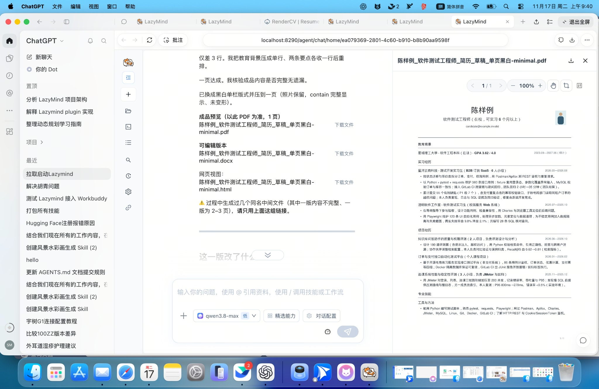
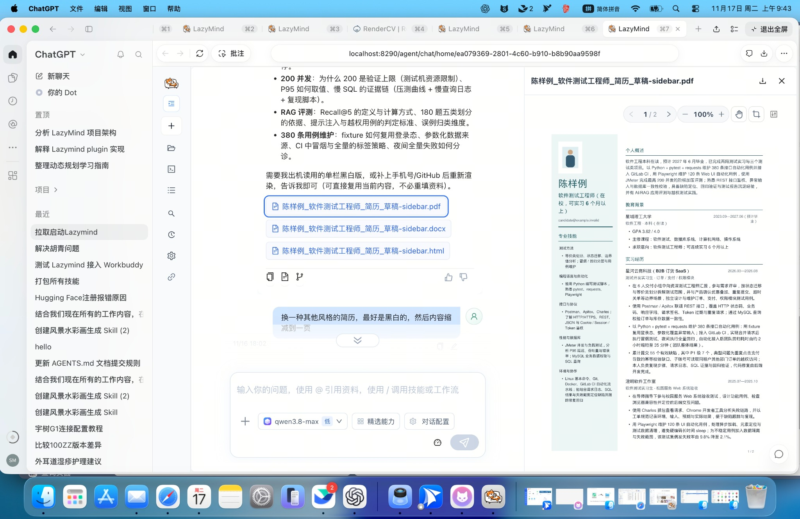
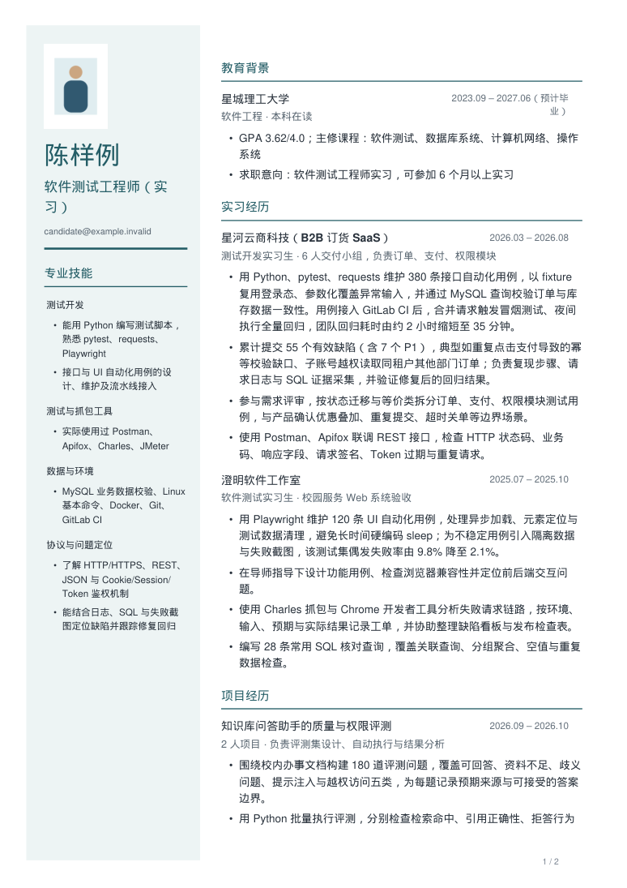
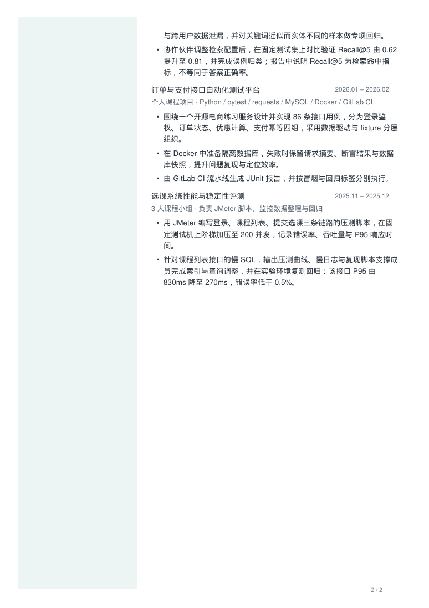

# 简历优化助手

在对话的「精选能力」中选择「简历优化助手」，提供现有简历、真实经历和目标岗位描述，即可生成带排版的 PDF、可编辑 Word（DOCX）及 HTML 预览文件。

## 选择模板与照片

发送前点击输入区的简历排版选项，选择模板。六种模板使用同一份简历内容：

| 模板 | 版式 |
| --- | --- |
| 商务蓝 | 单栏、蓝色分节，适合通用求职材料 |
| 现代色带 | 强调姓名和求职方向的色带页眉 |
| 专业侧栏 | 侧栏展示技能，主栏展示教育和经历 |
| 创意版式 | 大标题与编号章节，突出内容层级 |
| 校园清新 | 清爽分区，便于展示教育与项目经历 |
| 黑白 ATS | 简洁黑白单栏，便于打印和阅读 |

如需照片，先上传图片，再在排版选项中明确选择要使用的照片；也可选择当前对话已有的图片。未选择时不会添加照片占位框。

- **完整显示**：保留整张照片，必要时在框内留白。
- **居中裁切**：按照片框比例裁切，适合人物居中的照片。

照片支持 PNG、JPEG 和 WebP，大小不超过 10 MiB、像素不超过 2500 万。移除已选附件后，需重新选择照片或取消照片选项再发送。

## 生成与修改

1. 上传或粘贴现有简历、岗位描述及希望保留的经历，说明目标岗位。
2. 选择模板和照片后发送。资料不足时，按提示补充事实；不要将岗位要求直接当作自己的经历。
3. 打开生成的 PDF 检查版式，下载 PDF 用于投递，或下载 Word 继续编辑。
4. 需要换样式时，可直接要求「保留内容，改成黑白模板」；需要缩短时，说明希望保留的重点和页数。

只切换模板时可复用已有结构化内容和照片。缩短简历需要同时调整内容或版式，较长材料不保证自动压到一页。Word 的分页可能因编辑器和字体不同而与 PDF 有差异。

生成前后应核对日期、指标、熟练程度和个人职责；修改说明及待补充信息会与简历正文分开。黑白单栏有助于保持结构简洁，但不代表承诺任何 ATS 系统的评分或通过率。

## 版式效果

以下示例均使用虚构候选人材料。

### 黑白单页与照片

按用户要求压缩内容并调整为一页的示例：

### 侧栏模板与文件交付

侧栏模板可同时展示照片、技能和正文经历，并提供 PDF、DOCX 和 HTML 文件：

侧栏模板的完整两页 PDF 示例：

