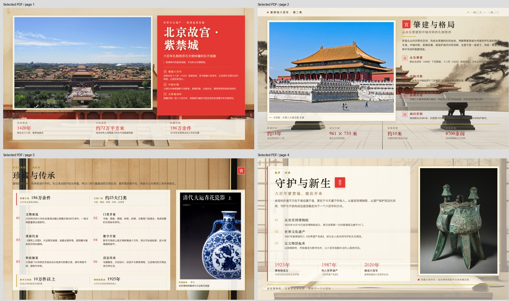

# 在现有 Agent 中，通过 LazyMind 插件审阅和修改 PPT

[English](README.md) · [案例首页](../README.CN.md)

**状态：已整理原始提示词和历史成果，当前版本复现待验收。**本篇复用已有故宫 PPT 案例，选择 DSH 录屏和对应 PDF 为主展示，Codex 录屏为补充。第二组的建筑全景与文物特写更突出；两组文件与检查结果见[材料记录](sources.md)。

[下载历史 PDF（无损 ZIP）](reference/palace-museum-dsh-reference.zip)。这是已有案例成果，不是本轮新生成文件；对应 PPTX 尚未取得。

## 要证明的使用收益

用户继续在 Codex 或 DSH 发起任务，通过 LazyMind 查看中间材料、审核和修改成果，再完成交付。要验证的是过程衔接带来的便利，不能仅凭“Agent 能生成 PPT”就宣称优势。

参考：[Codex 故宫 PPT](https://www.bilibili.com/video/BV1TppR6xEj7/)、[DSH 插件演示](https://www.bilibili.com/video/BV1Xcpt6REjc/)。已检查负责人提供的两段录屏，能看到来源、大纲与每页提示词审核、局部修改及导出查看。首次配置、工具发现、等待和面板确认仍需如实呈现，不宣称零操作或未经测量的效率提升。

## 原始任务

以下为负责人提供的原文，也保存为[纯文本](prompt.zh-CN.txt)：

> 调用lazymind mcp的ppt workflow，生成一套 16:9《北京故宫》主题 PPT，介绍故宫的历史、建筑格局、文化珍藏与保护传承。整体采用朱红、金色和米白配色，风格庄重典雅、东方古典、具有博物馆画册质感。需要收集素材图片，使用故宫建筑全景和文物特写，版式简洁、留白充足、图文结合，每页突出一个核心观点。

原文没有指定页数。两份历史成果均为四页，Codex 录屏中用户明确回答了四页；复现时如被追问页数，可回答“四页”，并把这条补充单独记录。网络资料和生成配图会变化，不保证重跑得到逐像素相同的页面。

本轮补充参数：四页，面向普通公众，启用 AI 底图；受众和底图开关由负责人于 2026-10-14 确认。建筑与文物主体仍使用检索图片。补充参数与上方原始提示词分开保存，不回写为历史原文。

## 运行前

完成[插件接入](../shared/agent-setup.CN.md)，使用上方原始任务。历史输入要求工作流收集素材；目前没有可固定复用的原始图片输入包，需保存本次实际采集的来源和文件，供同一次修改及对照使用。完整 DSH 局部修改指令仍待补齐。

## 复现步骤

1. 在 Codex 或 DSH 中新建任务，提供原提示词和原素材，要求使用 LazyMind PPT Workflow。由 Agent 发现工作流，不复制其他安装中的内部 ID。
2. 确认素材可读取，在面板查看资料、配图和大纲。保留一次用户调整以及生成前明确确认的记录。
3. 等真实任务完成，记录任务与产物修订，导出初稿 `deck-v1.pptx`，打开检查内容、版式与数据。
4. 使用原案例的局部修改要求，记录选中的页面/元素及操作过程；不能用整份重生成伪装局部修改。
5. 导出 `deck-v2.pptx`，逐页对照 V1：指定修改生效，其他页面内容与布局保留。文件哈希不同或相同都不能单独证明视觉结果正确。
6. 在明确版本的 PowerPoint 或 WPS 中打开 V2，实际修改文字、保存并重新打开。说明哪些元素可编辑，不把整页图片称为可编辑 PPT。
7. 核对面板最终结果与导出修订一致。对每个宣传为支持完整路径的宿主分别运行。

上述 V1/V2 文件名是待运行的成果要求。历史 PDF 可供预览，但第二组对应 PPTX、完整局部修改指令和修改前后文件尚未补齐，当前不能宣称完整验收通过。第一组的 PPTX 含原生文本和图片对象，只能证明其结构，不替代第二组的编辑、保存、重开验证。

## 证据与对照

按[验收记录](verification.md)保留证据。直接使用原 Agent 的对照允许正常的 PPT 能力，并使用同样提示词与素材；分别记录准备、审核、修改、导出、等待和人工操作。不能靠输入差异制造优势，也不能剪掉必要的 LazyMind 面板交互。

实跑后再加入真实成果和脱敏记录，保留失败与人工修正。60–90 秒视频可用于概览，但倍速等待或跨次拼接必须说明，不能把成片时长写成任务耗时。

## 复用的实现

直接使用现有 [PPT Workflow](../../workflows/ppt-workflow/README.md)。仓库另有[英雄联盟预览](../../skills/featured/ppt-workflow/featured.yaml)，它属于另一个案例，不能充当故宫成果。本篇不修改生产工作流或公共接口。
