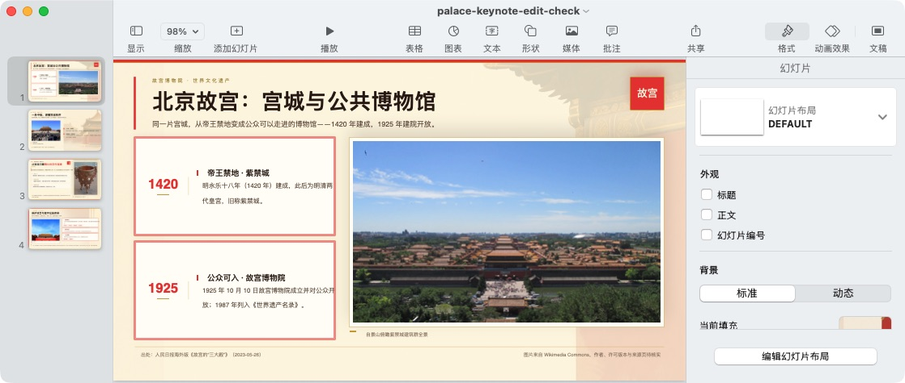

# Rendered-deck and export review / 成片与导出审核 — 2026-10-15

**Partial acceptance; final review remains pending / 部分验收通过，最终审核尚未通过。**

This is the same four-page Palace Museum run, `mcp-64c7a99d9707aea53a0102ccb383cb8f`, pinned to Workflow revision `17436653-d491-4098-88d9-9b871f2e407d`. Generation execution `pss_ce9d7235c893468db9040b86aff6b163` succeeded. Core state 208 still reported `awaiting_user`, with no active execution and the final review pending. Generation success is not full showcase acceptance.

同一次任务现已生成四页，主题依次为历史、建筑格局、文化珍藏、保护传承。逐页检查浏览器与实际导出的 PDF，未见明显裁切、缺图或黑块。第三页文物照片偏软；第一页、第三页、第四页仍有图片许可“待核实”的旧页脚，不能作为最终宣传成片。四页讲稿已在面板中逐条编辑、保存，加入真实图片作者、来源及许可链接；重新导出的 PPTX 四份 notes XML 中均核对到对应作者。

## Actual local edit / 局部修改实测

Selected page 1's title and submitted:

```text
仅将选中的第一页主标题改为“北京故宫：六百年宫城与公共博物馆”。保持标题原有字体、字号、颜色与位置；保持本页其他文字、图片、背景不变，不修改第2至4页。
```

The old parser included the trailing instructions in the title. This was a reproducible parsing bug, not a successful edit. Retrying the selected title with this single command produced the intended result:

```text
改为北京故宫：六百年宫城与公共博物馆
```

The exact before/after HTML comparison found only the visible h1, matching HTML title metadata and provenance comment changed on page 1. Pages 2–4 and all four notes were byte-identical at that checkpoint. Notes were deliberately updated later for attribution; do not confuse that later review with the title-only comparison. See [comparison hashes](acceptance-2026-10-15/local-edit-comparison.json).

旧正则把“改为”后全部内容作为新文本，导致约束漏入标题。用户批准的最小修复 `c234eceb` 只让完整的纯替换命令走快捷路径，附加约束复用现有结构化规划，不增加接口或依赖。新增回归覆盖原始失败指令、引号、标点、中英文约束及规划失败不回退为错误文本；局部修改文件 75 项测试、整个 PPT Workflow scripts 测试集 94 项通过（前者包含于后者）。

```sh
PYTHONPATH=algorithm/lazyllm:algorithm \
  local/build/deps/python/algorithm/bin/python -m unittest discover \
  -s workflows/ppt-workflow/scripts/tests
```

The pinned run still uses its older Workflow revision. The fix is committed and unit-tested, not claimed as deployed into that immutable revision or verified with a real model on this run. The workaround above is the actual live result. / 当前固定 revision 仍用旧代码，不能把源码测试通过写成该任务已上线修复。

## Export and editor check / 导出与编辑器验收

1. Product export initially reported missing editable-PPT dependencies. Installed through its existing settings page into the isolated 8091 runtime; no service restart or 8090 change. This setup/download cost belongs in reproduction instructions.
2. Product UI successfully downloaded a four-page 16:9 PPTX. ZIP/XML inspection found native text, shapes and an image on each slide, rather than one flattened image per page.
3. Keynote **14.5** opened the downloaded PPTX after the owner helped open the native file dialog. The coordinator selected the existing title text and changed it to `北京故宫：宫城与公共博物馆`.
4. Saved as a separate `.key` file, closed and reopened it, and verified the title persisted. Exported that file back to PPTX, closed and reopened the PPTX in Keynote: the changed title and four slides remained. This proves an actual editor roundtrip, not PowerPoint/WPS compatibility or independent reproduction.
5. Keynote reported missing `Noto Serif SC`. Font substitution visibly differs from the browser; exact layout fidelity is not established. Install the deck's fonts on the viewing device when layout fidelity matters, and compare against the PDF.

真实完成了原生文本修改、保存、重开及 PPTX 往返导出。第一次打开需要负责人协助，不能隐去该人工操作。PowerPoint 未成功打开文件，本轮不声称在 PowerPoint 中验收。Keynote 的验收副本使用补充图片署名前的版本；仓库附带的产品导出则包含之后补齐的四页讲稿。

- [Actual product PPTX with reviewed notes](acceptance-2026-10-15/palace-notes-reviewed.pptx)
- [Actual four-page PDF, lossless ZIP](acceptance-2026-10-15/palace-title-edited-pdf.zip)
- [Export structure and editor evidence](acceptance-2026-10-15/export-checks.json)
- [Image attribution and licenses](image-attribution.md)



## Remaining acceptance / 尚未通过

- Replace stale visible footer placeholders using the product editing path. The first two attempts on page 1 returned DeepSeek HTTP 503 `provider_overloaded` at 09:37 and 09:39 (Asia/Shanghai), before any output. A later manual retry also failed with HTTP 503 (diagnostic `b1ef11d28bf94ac892d3eb1811728da6`); no successful edit was produced. This is separate from the title parsing bug; no successful footer edit is claimed.
- Verify the parser fix in a supported new Workflow revision; do not overwrite the pinned run's definition to manufacture a pass.
- Complete current-version DSH PPT execution, final review/state matching and colleague independent reproduction. Existing DSH promotional video is reference material only.

The value demonstrated so far is inspectable intermediate outputs, visible review/rewind history, a targeted edit with preserved other pages, and editable export from the same Agent-initiated task. Configuration, model failures, review corrections and manual opening help remain visible. No speedup or zero-operation claim is made.
