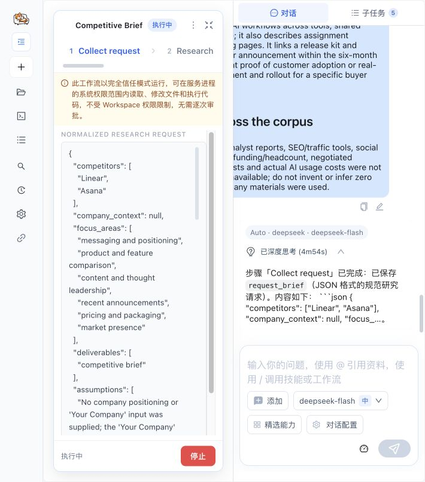

# Competitive Brief: a real Skill2Workflow compatibility trial

[中文](README.CN.md) · [Reproduction](REPRODUCTION.md) · [Evaluation](EVALUATION.md) · [Implementation audit](AUDIT.md) · [Sources](SOURCES.md)

**Status: compatibility experiment, not a successful autonomous Showcase.** Anthropic's pinned competitive-brief Skill was genuinely installed, converted by LazyMind's hosted model-backed service, published and executed. The first external task failed at the third of five generated steps. A step-scoped retry recovered that step without changing the generated Workflow. The original failed task remains part of the evidence.

Assisted continuation subsequently completed the session and produced a report. That report still has groundedness issues, both tested edit routes failed, and human review remains pending. These limits are why this case is submitted as a Draft compatibility report.

## Business question

A PM at a 20-person software team needs to compare Linear and Asana for product development and cross-functional launch planning. The deliverable is a seven-section competitive brief with product positioning, features, annual seat pricing, evidence-bounded content gaps and 3–5 actions. Facts, inferences and unavailable information must be distinguishable; a person must review the recommendation before acting.

The original Skill packages useful research instructions. A Workflow could make the research, analysis and report individually inspectable and recoverable. This experiment tests that proposition with real outputs rather than assuming that a graph guarantees reliability.

## What was actually run

- Three original-Skill Codex CLI runs, each reading the pinned Skill, its CONNECTORS reference and the same frozen task/corpus.
- One rejected GitHub `/blob/.../SKILL.md` import probe, followed by one supported pinned `/tree/.../competitive-brief` submission.
- Automatic installation → Preflight → generation → publication → execution through `POST /external-agent/workflow-tasks`.
- The generated five-step package and actual session projections, artifact revisions and failure records are preserved. No production code, original Skill text or generated YAML was edited to make the run pass.
- A separate assisted recovery uses the official session advance API. Its results are distinguished from the failed autonomous run in [Evaluation](EVALUATION.md).

Both modes used **offline replay of seven operator-selected, paraphrased official-source fact cards**, acquired live on 2026-10-27. This tests bounded synthesis and orchestration; it does not test live retrieval, paid market intelligence, product usability or complete market coverage.

## Read the evidence

| Evidence | Location |
| --- | --- |
| Fixed inputs and acceptance | [Task](evidence/task.md), [source cards](evidence/source-cards.md) |
| Original-Skill reports | [Run 1](evidence/baseline/run-1.md), [run 2](evidence/baseline/run-2.md), [run 3](evidence/baseline/run-3.md) |
| Actual generated package | [workflow.yaml](evidence/generated/workflow.yaml), [state.yml](evidence/generated/state.yml), [scenario](evidence/generated/scenario.md) |
| Conversion and execution states | [HTTP recordings](evidence/http/), [manifest](evidence/manifest.json) |
| Runtime provenance | [Environment](evidence/environment.json) |
| Observed product issues | [Issue record](ISSUES.md) |

The real Panel screenshot below was captured during this experiment's execution, after collapsing unrelated navigation. It demonstrates the displayed running state, not successful completion or human approval.

## Limits and intended audience

This is useful for PMs and knowledge workers evaluating inspectable research handoffs, and maintainers checking Skill compatibility. It is not evidence of better output quality, lower cost or general conversion stability. The deployed Core binary has a recorded hash but no VCS revision; current-main code audit/regression tests and deployed E2E evidence are explicitly separate. No human approval was obtained, and generated steps contain no mandatory approval gate.

Unlike the existing Product Solution Delivery package and the Superpowers example, this case starts from an independently pinned knowledge-work Skill and exercises hosted automatic conversion with a fixed-corpus original-Skill baseline.
