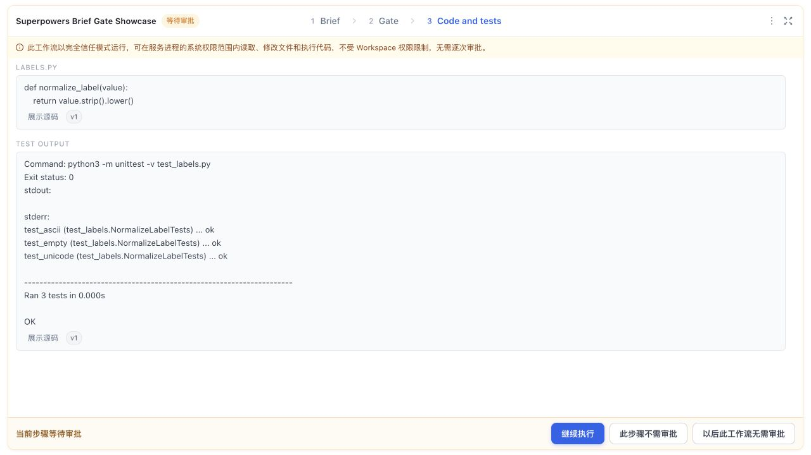
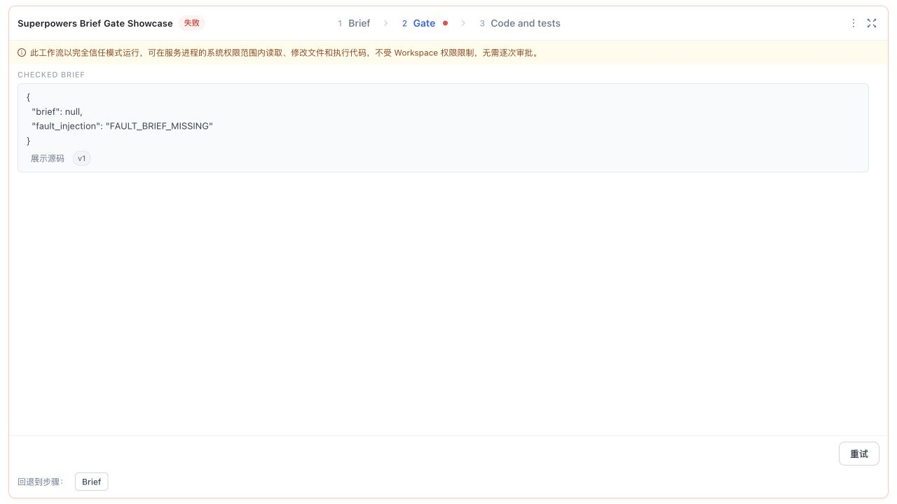

# Try the Brief gate

[Setup in Codex](README.md#try-in-codex) · [Real receipts](evidence/showcase/receipt.json)

The native Skill baseline **passed**. Missing Brief is explicit **fault injection**,
not a natural reproduction of #2282. Video status: **NOT_RECORDED**; recording is optional.

## Reproduce two separate runs

1. Connect the official plugin and enable the package using the setup above. Ask:
   “Use the LazyMind Workflow plugin to run Superpowers Brief Gate Showcase.
   Open its Panel. Implement only in a new disposable directory and stop for review.”
2. Inspect **Brief → Gate → Code and tests**. If Codex stops after native validation,
   continue in the same bound task: “Re-read the LazyMind Workflow state and continue
   only the next authorized step.” Our actual plugin test used manual continuation.
   Inspect `labels.py`, the three tests and their Artifacts; approve with the Panel's
   **Continue execution / 继续执行** button and check completion.
3. Start a **new** Workflow session with:

   ```text
   Use the LazyMind Workflow plugin to run Superpowers Brief Gate Showcase.
   FAULT_BRIEF_MISSING
   ```

4. Confirm the Brief contains `null`, Gate fails with `BRIEF_MISSING`, and
   implementation has no admitted attempt. Preserve the failed state for inspection.




The [receipts](evidence/showcase/receipt.json) retain separate Session IDs, plugin
calls, completion after approval, file/Artifact checks and a real Core **409
WORKFLOW_ADMISSION_DENIED** probe. The normal image is not recovery of the failed
session. A native validator ran; only implementation was blocked. Git Base and
Coverage belong to [Advanced CLI](ADVANCED.md), a separate execution path.

## Optional 60-second recording

Prepare both runs above, leaving the normal one awaiting approval. Open their live
Panels and the actual Codex conversation. Record a walkthrough of prepared sessions,
**not** a 60-second execution benchmark. On macOS press **Shift–Command–5**, select
the Codex/Panel area and save outside Git (e.g. Movies); hide credentials and unrelated
tasks. [Apple recorder instructions](https://support.apple.com/en-au/guide/mac-help/mh26782/27/mac/27).

| Time | Live action | English narration |
| --- | --- | --- |
| 0–8s | Show [native PASS](evidence/public/native.json) and #2282 context | “Missing Brief is deliberate fault injection.” |
| 8–18s | Show actual plugin start and manual continuation in Codex | “Keep Codex. LazyMind controls Workflow admission.” |
| 18–35s | Click normal Panel Brief, Gate, Code and tests | “Inspect the Brief, source and actual test output.” |
| 35–43s | Approve; show completed status | “Human review completes this run.” |
| 43–55s | Switch to the failed run; show null Brief and Gate error | “Implementation was not admitted.” |
| 55–60s | Show the limitations below; stop recording | “Automatic continuation and native Retry remain follow-ups.” |

Keep recording if an action takes longer; label any later time cuts. Never stitch
screenshots or synthetic UI into a claimed continuous recording. Desktop automatic
continuation and edited-input same-session Retry remain unfinished follow-ups,
not prerequisites for trying or reviewing this Showcase.

Play back the recording, then drag the `.mov`/`.mp4` into a [PR #852 comment](https://github.com/LazyAGI/LazyMind/pull/852),
wait for the attachment URL, preview and submit ([GitHub instructions](https://docs.github.com/en/get-started/writing-on-github/working-with-advanced-formatting/attaching-files)).
Caption: “Live walkthrough of prepared plugin sessions; manual continuation;
missing Brief is fault injection.” Keep video/GIF files out of Git.
No recording or comment has been published by this update.
